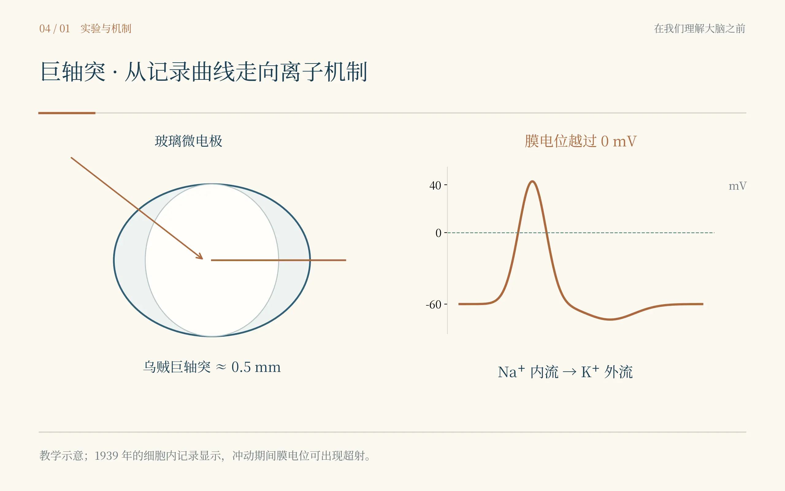
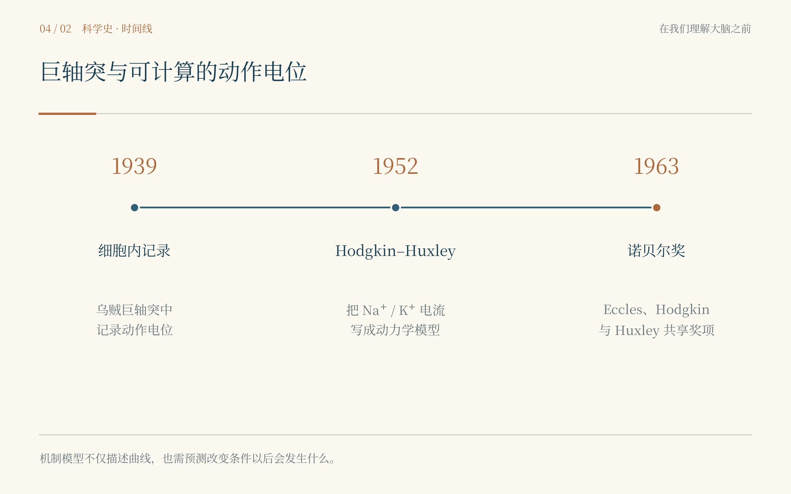

# 第四章　一根比铅笔芯还粗的神经

*Hodgkin × Huxley × Eccles：动作电位究竟是什么？*

海风从门缝里灌进来，把一张薄纸掀到了地上。有人弯腰去捡，手里的器械却不肯放下。我站在门口，先闻到海盐和机油混在一起的味道，才看见那根被小心固定的乌贼神经。它比我在书上见过的粗得多，却仍然脆弱，像一根不许随便碰的细线。桌边两个年轻人都没有抬头，仿佛屋外的大海只是替他们运送实验材料的地方。

我抬头时，先看见一张比现代实验台粗糙得多的长桌，再看见窗外灰蓝色的海。空气里有盐、动物组织和机油的味道。一个年轻人正盯着竖起来的乌贼神经纤维，旁边是一滴极小的水银。

“它不动。”他说。

“什么不动？”

“水银。”

他抬头，我认出了Andrew Huxley。只是1939年的Huxley才二十一岁，比后来所有正式肖像都年轻得过分。他的脸还没有那种老年学者的沉稳，眼神却已经很像一个工程师：先看装置，再看人；先判断哪里能改，再判断理论对不对。

另一边的Alan Hodgkin二十五岁，比他年长不了多少。两个人站在一起，与其说像后来会获得诺贝尔奖的两位爵士，不如说像刚刚把实验做坏的两个年轻研究者。

“你们在测什么？”我问。

“轴浆的黏度。”Huxley说。

方法听起来简单：把乌贼的巨轴突竖起来，放入小水银滴，看它在轴浆中怎样下落。如果轴浆像普通液体，水银应该移动。结果它几乎一动不动。

我本来以为自己穿越到这里就是为了见证动作电位的伟大发现，没想到开场是一个失败的黏度实验。

Huxley却没有立刻把装置拆掉。他盯着那根被固定得很直的巨大轴突看了一会儿，说：“既然它能这样撑住，也许可以把一根毛细管从里面推进去。”

Hodgkin转过头。

我也转过头。

这句话听起来并没有任何“历史时刻”的气势。

可很多实验突破就是这样发生的：一个原本为A问题搭起来的装置失败了，却把B问题突然变得可做。

乌贼巨轴突是神经科学史上最著名的“尺度优势”之一。大多数神经纤维细得让当时的电极很难真正进入细胞内部，乌贼为了快速逃逸，却进化出直径可达约半毫米的巨大轴突。对动物来说，它是提高反应速度的生存结构；对生理学家来说，它像自然界提前准备好的一根可操作电缆。

Hodgkin此前已经在美国伍兹霍尔跟Kenneth Cole学习过处理乌贼巨大轴突的方法。他的手比Huxley更稳，做决定也更慢。Huxley会很快提出一种机械方案，Hodgkin则习惯先想哪里可能出错。两个人的差异没有让合作变困难，反而像一台仪器里的两个部件：一个不断产生新的办法，一个不断降低这些办法自欺的可能。

玻璃微电极被一点点送入轴突内部。

我不敢说话。

今天的学生看到“intracellular recording”会想到一张标准方法图：细胞内一支电极，细胞外一支参考电极，屏幕出现膜电位。真正看他们把那根细玻璃管推进去，我才理解为什么这是技术突破。电极必须进入轴突，又不能严重破坏膜；记录系统必须足够灵敏；几百微伏、几十毫伏的变化必须从一堆噪声中稳定留下来。

刺激给出。

曲线猛地向上。

越过零。

我盯着屏幕，知道自己看到的是什么。

静息时，轴突内部相对外部带负电。按照当时一种简单看法，动作电位可能只是膜突然“失去选择性”，让原本的电位差消失。如果只是这样，曲线顶多接近零。

可它没有停在零。

它冲到了正值。

“过了。”Huxley说。

Hodgkin没有庆祝。

“先别这么说。”

“它过零了。”

“我们还不知道液接电位有多大。”

我差点笑出来。历史已经告诉我，他们看到的是动作电位的overshoot——电位反转，细胞内部短暂变得比外部更正。这个结果后来会成为离子机制的关键线索。但在实验发生的当天，Hodgkin首先想到的仍然是：会不会是测量系统骗了我们。

这和Cajal看到一张太漂亮的切片时先怀疑切片，几乎是同一种科研本能。

真正好的结果并不会让严谨暂停。恰恰相反，结果越漂亮，越应该问仪器有没有制造它。

***

他们没有多少时间慢慢消化这个结果。

1939年夏末，欧洲的空气正在变坏。乌贼终于大量运到Plymouth时，战争也越来越近。就在最重要的记录刚刚出现后不久，德国入侵波兰，英国进入战争。实验被迫中断，两个人匆忙把结果写成一篇很短的Nature通讯。

几页纸，几条曲线，几乎没有后来教科书那种完整解释。

然后是七年。

科学史经常把1939和1946之间用一个破折号带过，可对一个人的人生来说，七年绝不是破折号。Hodgkin转去做航空医学和雷达相关工作，Huxley参与防空和海军炮术研究。他们必须学习反馈、控制、预测、噪声和工程计算。这些技能后来又悄悄回到生理学里。\[4.1\]

我第一次意识到，科研训练并不总沿着论文主题直线积累。有些看起来“偏离课题”的经历，最后会改变一个人怎样思考问题。

战争结束以后，Plymouth的实验室也需要修复。等他们真正重新回到乌贼轴突，那个1939年留下的问题仍在那里：为什么膜电位会反过来？

最直接的猜想逐渐集中到钠离子。

细胞外钠浓度很高。如果动作电位期间膜突然对钠高度通透，钠离子就会沿着电化学梯度冲进细胞，把膜电位向钠的平衡电位推过去。这不仅能解释去极化，也能解释为什么曲线可以越过零。

“猜想很漂亮。”我说。

Hodgkin看着我。“所以要想办法让它难堪。”

他们降低外液中的钠浓度，用不容易穿膜的离子替代一部分钠。如果“钠进入”真是动作电位上升的关键，那么外面可用的钠减少以后，动作电位的上升和超射就应该变小。

结果正是这样。

这是我在穿越中越来越喜欢的一种实验逻辑：不要只问“我的理论能解释已有结果吗”，而要问“如果理论是真的，改变一个关键条件以后，结果必须怎样变化”。前者很容易讲故事，后者才真正让理论承担风险。

可知道“钠很重要”仍然不够。动作电位是极快的动态过程，总电流里混着不同离子的贡献。你看到一条曲线，却不知道里面有多少个过程叠在一起。

于是问题变成：能不能让膜电位先别自己乱跑？

“把它钳住。”Huxley说。

电压钳的思想听上去近乎粗暴：既然膜电位变化会反过来改变离子通透性，那就用反馈系统把膜电位固定在研究者设定的水平，然后测为了维持这个电压，系统必须补偿多少电流。这样，膜不再自由地产生完整动作电位，而是被迫在一个个指定电压上“回答问题”。

我第一次真正理解为什么实验控制会带来信息。

自由状态下，你得到的是系统整体行为；把一个变量固定住，你才有机会看到其他部分如何响应。

现代统计分析也一样。所谓控制协变量、匹配、干预、分层，背后都有类似愿望：尽量把同时变化的东西拆开，逼近某一条关系本身。当然，真实生物系统永远比电压钳更难控制，但思维方式是相通的。

Hodgkin和Huxley看到，在某些电压阶跃下，膜电流先出现快速的向内成分，随后出现更慢的向外成分。结合改变外液离子浓度的实验，他们逐渐把前者和钠联系起来，把后者和钾联系起来。

“所以动作电位不是一种电流。”我说。

“当然不是。”Huxley回答。

“而是至少两个时间尺度不同的过程叠起来。”

“现在开始像个问题了。”

他讲话经常这样，像在夸你，又像只给了半分。

接下来的工作最不像传奇。

没有闪电，没有欢呼，更多是表格、曲线和计算。

1946—1947年的冬天异常寒冷，燃料短缺，有些时候实验条件差到不适合继续操作。Huxley会坐在房间里算方程，用机械计算器一遍遍处理数据。他对仪器有一种近乎手工业者的熟练：小时候就喜欢车床，后来能自己设计和改造显微镜、微操纵器和各种装置。对他来说，数学和机械不是两种语言，只是同一种精确性在不同材料里的表现。

我曾经站在他旁边看了十几分钟，只看懂一半。

“你是在拟合这条曲线？”我问。

“不是。”

“那你在干什么？”

“找一套变化规律，让曲线自己出现。”

我一下安静了。

今天很多模型可以把数据拟合得极好，尤其机器学习以后，预测性能甚至可以远高于我们解释机制的能力。但Hodgkin–Huxley模型最迷人的地方不只是它“拟合动作电位”。它把膜电流写成几个可以被生理意义解释的部分：钠电导怎样随时间和电压打开、失活，钾电导怎样延迟增加，泄漏电流怎样存在。然后把这些过程放在一起，动作电位从方程里自己长出来。

一个好模型不是给图上加一条更顺的线。

它应该像一台缩小的机器：你改变里面的零件，外面的行为也必须跟着变。

1952年，那一系列著名论文发表。后来所有神经科学学生都会看到m、h、n，会背钠通道激活、失活和钾通道开放，会在考试里画出标准动作电位。可站在那些纸张真正被计算出来的年代，我第一次觉得公式不是对生命的简化，而是另一种观察工具。\[4.3\]

显微镜让Cajal看到结构。

放大器让Adrian听见脉冲。

方程让Hodgkin和Huxley看见机制之间的关系。

工具不一定长得像仪器。

***

如果第四章到这里结束，它会是一则非常漂亮的“电生理胜利史”。

可神经科学真正让我着迷的地方，是答案常常会在别人的错误里再长一次。

1951年，我在新西兰Dunedin见到John Eccles。

如果说Hodgkin的性格像一支经过校准的电极，Eccles更像一个永远把增益开得偏高的放大器。他说话快，走路快，讨论理论时会整个人向前倾。他不缺自信，甚至在一些同行眼里自信得过头。更重要的是，在“突触究竟主要靠电还是靠化学”这场长期争论里，他曾经坚定地站在电学解释一边。

这让我很感兴趣。

历史书喜欢采访“最后正确的人”，可科研训练真正困难的地方，往往是你如何处理自己认真相信过、甚至公开捍卫过的错误理论。

Eccles并不是随便相信一个想法。他试图把电传递假说说得足够具体，使它能够被实验击中。1945年前后，他和哲学家Karl Popper相识，后者关于“可证伪性”的思想给了他很大刺激：科学不是不停收集支持自己的例子，而是提出足够大胆、足够清楚的假说，再想办法把它推到最危险的位置。

“你的理论如果永远不会输，”Eccles对我说，“它也就永远没有真正赢过。”

这句话不是历史原话，却非常像他那几年做的事。

他把自己的电学假说写得越来越明确。对于脊髓运动神经元的抑制，如果他的机制是对的，细胞内记录应该出现某一种电位方向；如果化学性抑制通过改变膜离子通透性起作用，结果则应该相反。

1951年8月的一天，细玻璃微电极真正进入运动神经元。

记录出现。

方向错了。

不是仪器“错”，而是理论错。

我第一反应是看Eccles的脸。

如果这是我的论文核心假说，我大概会先检查电极，再检查参考端，再检查动物状态，再怀疑统计，再提出三种“也许还可以解释”的可能。科研人员并不比普通人更喜欢承认自己错，只是职业要求我们训练这种能力。

Eccles也检查了。

但检查完成以后，他没有试图把结果塞回旧理论。

“那就不是它。”他说。

就这样？

我盯着他。

后来他的传记里会写，他甚至学会为一个珍爱的理论被证伪而高兴，因为这仍然是一种科学成功。真正站在那天晚上，我觉得“高兴”可能太干净了。一个人放弃自己长期公开捍卫的理论，不可能完全没有疼痛。但他的确做到了更重要的事：没有把个人声誉和理论绑死。

我忽然理解，所谓“科研自信”不应该是永远相信自己对。

更高级的自信，是相信即使自己错了，也有能力继续往前走。

之后Eccles和同事利用细胞内记录，把兴奋性和抑制性突触后电位真正放到神经元膜上测量，逐步解析它们的离子基础。Sherrington几十年前从反射行为中推断出的“抑制”，终于变成一条可以直接记录的膜电位变化。

这是一条让我几乎起鸡皮疙瘩的科学连续线。

Sherrington先从整条腿的运动推断“中间一定存在抑制”；Eccles后来把电极插进单个运动神经元，让抑制第一次在细胞内部留下电信号；Hodgkin和Huxley又提供了一套更基础的离子框架，解释膜电位为什么能够变化。

宏观行为、细胞信号、离子机制，在几十年里一层层扣到一起。

我以前做跨尺度研究时，总喜欢在摘要里写“从分子到脑网络”“从微观到宏观”。站在这里才发现，真正的跨尺度不是把多个数据层放进同一张图，而是每一层都必须对上一层提出的具体问题负责。

***

1963年12月10日，我再次站在斯德哥尔摩音乐厅。

Alan Hodgkin、Andrew Huxley和John Eccles共同获得生理学或医学奖，理由是他们对神经细胞膜兴奋和抑制离子机制的发现。

三个男人站在同一个领奖台上，性格几乎没有一处相同。

Hodgkin仍然显得克制，像随时准备提醒别人“数据还没有完全支持”；Huxley沉静得近乎工程师，把注意力放在问题而不是仪式上；Eccles则有一种明显更强的舞台感，哲学、神经生理和对心智的兴趣在他身上混在一起。

那一晚Hodgkin的宴会答谢让我记了很久。他提到，三十一年前Sherrington和Adrian刚刚获得同一奖项；Eccles是Sherrington的学生传统中的人物，而他和Huxley则属于Cambridge、Adrian所代表的另一条神经生理传统。他说，Alfred Nobel大概会喜欢看到奖项不仅奖励科学的新颖，也强调科学的连续性。

我听到这里，突然想起第二章里的老Sherrington。

他没有亲眼看到1963年的这一幕，却早就把“整合、兴奋、抑制、突触”这些问题交给了下一代。Cajal也不会看到离子通道时代，可如果没有“神经元彼此独立”的结构框架，后面的膜、突触、动作电位根本无从谈起。

科学史不是一排雕像。

更像一个持续接力的实验室。

典礼结束后，我一个人走到外面。斯德哥尔摩的冬夜很冷，我却一直在想Hodgkin–Huxley模型。

一个神经冲动已经可以被拆成钠、钾、电导和时间常数；兴奋和抑制也可以在单个神经元膜上测量。我们终于越来越像是在“理解一台机器”。

可这台机器从哪里来？

一个成年神经元会放电，会释放递质，会响应突触输入。但胚胎最初没有一张完成的线路图。数十亿细胞怎样长出轴突？为什么某些神经元活下来，另一些会死？它们怎么找到目标，怎么知道该在那里停下？

如果一个成熟的大脑像一座城市，那么前四章一直在研究道路上的交通。

可还没有人告诉我，这座城市最初是怎么建起来的。

冷风里忽然出现一股鸡蛋壳和酒精灯混在一起的味道。

再睁眼时，我站在一间卧室里。

床在左边。

显微镜在右边。

一个年轻女人正在把缝衣针磨成手术刀。

---

## 史实与创作说明

1939年Hodgkin与Huxley在Plymouth海洋生物实验室利用乌贼巨轴突完成早期细胞内动作电位记录，并观察到动作电位“超射”至零电位以上。第二次世界大战中断了研究，两人分别参与航空医学、雷达和炮术等战时工作；战后重新回到神经生理学。1940年代末至1952年的离子替换、电压钳和定量分析最终形成Hodgkin–Huxley模型。John Eccles曾长期捍卫中枢突触的电传递解释，1951年前后的细胞内记录结果推翻了自己的关键预测，随后转向化学突触机制并系统研究兴奋与抑制的离子基础。1963年Hodgkin、Huxley与Eccles共同获得诺贝尔生理学或医学奖。

本章的学习线索是“测量—操纵—建模—证伪”：先把信号从细胞内测出来，再通过改变外液离子和固定膜电位拆分过程，随后用数学模型把多个过程重新合成，最后让模型产生可以被实验推翻的预测。对今天的计算生物学和AI研究同样重要：预测性能不等于机制解释，一个有科学价值的模型最好能够告诉你“改变哪个变量，会发生什么”。

## 本章插图

{fig-align="center" width="90%"}

{fig-align="center" width="90%"}

## 本章参考文献

- [4.1] Hodgkin AL, Huxley AF. Action potentials recorded from inside a nerve fibre. Nature. 1939;144:710–711. doi:10.1038/144710a0.
- [4.2] Hodgkin AL, Huxley AF. Currents carried by sodium and potassium ions through the membrane of the giant axon of Loligo. J Physiol. 1952;116(4):449–472. doi:10.1113/jphysiol.1952.sp004717.
- [4.3] Hodgkin AL, Huxley AF. A quantitative description of membrane current and its application to conduction and excitation in nerve. J Physiol. 1952;117(4):500–544. doi:10.1113/jphysiol.1952.sp004764.
- [4.4] Nobel Prize. The Nobel Prize in Physiology or Medicine 1963: John Eccles, Alan Hodgkin and Andrew Huxley.
- [4.5] Eccles JC. The Ionic Mechanism of Postsynaptic Inhibition. Nobel Lecture, 11 December 1963.
- [4.6] Huxley AF. Nobel Lecture, 11 December 1963; Hodgkin AL. Nobel Lecture and Banquet Speech, December 1963.
