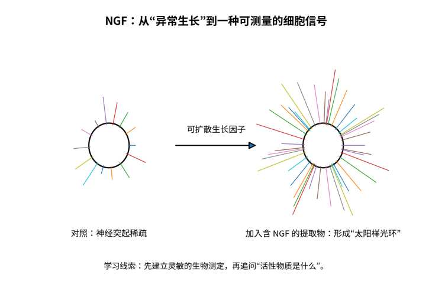
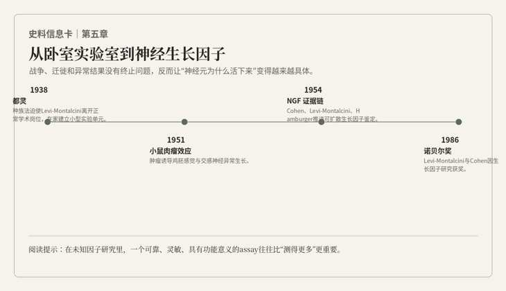

# 第五章　卧室里的实验室

*Levi-Montalcini × Cohen：神经系统如何长出来？*

“别碰那盒蛋。”女人没抬头，声音不高。我伸到半空的手停住了。窗边的桌子上有一盏灯、几只玻璃皿和几枚鸡蛋，床就在另一边。谁家把卧室布置成这样，我一时说不清。她用铅笔在一张纸上作了记号，才抬头看我，仿佛我并不是从另一个世纪跌进来，只是一个来得太早、还没找到事做的帮手。

我刚伸出的手停在半空。

桌上有一排鸡蛋，旁边是显微镜、酒精灯和一些我第一眼甚至没认出用途的细小工具。房间另一侧真的摆着床。不是“像卧室的实验室”，而是卧室本身。

1940年的都灵。

Rita Levi-Montalcini。

她比后来那些银发、黑白套装的著名照片年轻得多，身材很瘦，动作极快。最让我意外的是她的整洁。房间条件简陋，器材甚至带着自制痕迹，可每一样东西的位置都清楚，连临时磨制的器械也排得像正式手术盘。

“这是手术刀？”我问。

“本来是缝衣针。”

“这个呢？”

“眼科剪。”

“镊子？”

“钟表匠的。”

她终于抬头看我。“还有什么问题？”

我把“你以后会得诺贝尔奖”咽了回去。

1938年的意大利种族法已经把犹太人排除在许多学术和专业职位之外。Levi-Montalcini不能像正常年轻医生和研究者那样继续在大学工作。短暂去过比利时以后，战争逼近，她又回到都灵。摆在她面前的选择很简单也很残酷：离开，或者在不依赖正式机构的条件下继续做一点还能做的研究。

她选了后者。

于是卧室变成实验室。

后来很多传记会把这一段写成“逆境中的坚持”。真正住在这个房间里几天，我反而觉得她很少把自己放在“受难者”的位置。她当然知道发生了什么，也从不淡化歧视和迫害，但工作时几乎不浪费时间抱怨环境。问题能不能做、鸡胚发育到第几天、切片有没有损伤，比“为什么命运对我不公平”更占据她的注意力。

这种性格并不温柔，却异常有力量。

她年轻时原本连上大学都不是家庭默认选项。父亲受当时观念影响，认为专业职业会妨碍女性作为妻子和母亲的责任。二十岁左右，Rita决定不接受这样的生活安排，在大约八个月里补完拉丁文、希腊文和数学等课程，进入都灵大学医学院。她的老师Giuseppe Levi以严格著称，实验室里后来走出三个诺贝尔生理学或医学奖得主：Salvador Luria、Renato Dulbecco，以及眼前这个正在磨缝衣针的女人。

我第一次听说这件事时，总觉得“一个导师培养三个诺奖”像某种天才孵化器神话。真正见到Giuseppe Levi以后，我才发现事情没有那么浪漫。

他脾气很大。

至少对实验很大。

有一天他看完一张切片，直接问Rita：“你为什么切成这样？”

“因为组织——”

“我问的是为什么，不是借口。”

我在旁边都替她紧张。Rita却没有退。两个人很快开始争论切片方向和神经节细胞计数方法，音量越来越高，最后又一起坐回显微镜前。

后来Rita告诉我，Levi对她最大的影响不是教会某一种染色，而是训练她对生物学问题保持严格。他会给出很难、甚至不太合理的问题。她早年曾被要求研究人脑沟回怎样形成，后来她自己回忆，那简直是一个糟糕到无法解决的题目。她没有因为“导师给的题目”就一直耗下去，而是在获得允许后转向更适合实验操作的鸡胚神经系统。

这件事让我有点意外。

博士生常常把坚持当成美德，却不太敢讨论“什么时候应该放弃一个坏问题”。科研训练并不只是学会把困难问题做下去，也包括识别一个问题是否真的可被当前方法回答。

鸡胚给了她一个可操作的世界。

发育中的脊髓、运动神经元、外周靶器官，都可以在相对清楚的时间窗口里观察。她特别关注一个看似简单的问题：如果胚胎某一侧的肢芽被去掉，原本应该支配那里的神经细胞会怎样？

过去一种直觉是，外周组织可能“诱导”神经元产生。Rita反复观察以后，逐渐形成不同理解：神经元早期可以先产生，但如果没有合适的靶组织，它们中的一部分后来会死亡。外周并不只是告诉神经元“你应该出生”，还可能决定“你能不能活下去”。

这个区别非常重要。

产生和存活，不是一回事。

今天我们研究任何复杂表型，也很容易犯类似错误。一个时间点看到数量减少，你不能自动知道是“生成少了”，还是“死亡多了”，或者“迁移走了”。静态差异不能替代过程机制。

Rita在鸡胚里学会的，首先就是尊重时间。

***

战争没有尊重她的实验时间。

都灵轰炸加重以后，一家人搬到乡间，她把小型实验室也搬过去。为了继续做鸡胚，她会骑车去附近农家找受精鸡蛋。1943年德军占领意大利北部后，危险进一步升级，Levi-Montalcini一家逃往佛罗伦萨，以假身份和地下状态生活。那几年，她还为难民和战争中的普通人提供医疗帮助。

我在穿越里第一次真正感到，所谓“科研环境”不是一句经费多少、平台多大的话。

有些年代，继续研究本身就是在和历史抢时间。

战争结束后，她回到都灵。1947年，一封来自美国的邀请改变了后面的故事。

Viktor Hamburger，Washington University的实验胚胎学家，读到了她在战争期间完成的工作。最有意思的是，他们观察到的结果并没有根本不同，解释却不同。Hamburger早年切除鸡胚肢芽后，认为外周靶组织影响神经系统的分化；Rita更强调神经元先产生、随后因失去靶源性支持而死亡。

按照我熟悉的学术世界，这完全可以发展成几年论文互相引用、互相反驳。

Hamburger却给她写信，请她来St. Louis，干脆把实验一起重做。

“他不怕你证明他错？”我问。

Rita正在收拾玻片。“如果他怕，就不会邀请我。”

我后来在St. Louis见到Hamburger本人。他比Rita温和，讲话慢一些，对公开争论兴趣不大，却有一种很强的实验胚胎学传统：同一个现象有两种解释，那就尽量把两个人放到同一套实验系统里，看哪一种更能活下来。

他们真的重做了。

结果更支持Rita的解释。

多年以后，Hamburger自己回忆这段往事时会说，最后发现“她是对的，像往常一样”。这种话只有在一个科学家不把“谁对谁错”和“谁更有价值”完全绑在一起时，才能说得轻松。

可真正把他们带向NGF的，不是这场争论本身。

而是一块肿瘤。

一名研究者把小鼠肉瘤组织移植到鸡胚后，观察到周围感觉和交感神经出现异常旺盛的生长。Rita看到这些结果时，最先吸引她的不是“长得多”，而是“长得不合常理”。

有些神经纤维在离肿瘤很远的区域就已经明显增生；更奇怪的是，她看见神经纤维甚至进入与肿瘤相连的血管周围。它们不像正常神经那样只是寻找一个需要被支配的靶器官，更像被某种来自远处的东西吸引。

“它在叫它们过去。”她说。

“谁？”

“肿瘤。”

“靠什么？”

她没有回答。

这就是一个真正的新问题诞生时的样子。

不是“我们发现NGF”。

而是：“这东西为什么会这样长？”

如果神经纤维必须直接接触肿瘤才能被刺激，解释可以是局部组织相互作用；如果肿瘤和神经组织彼此不接触，却仍然能让神经异常生长，那么就必须有某种可扩散信号。

他们把肿瘤移到鸡胚外的绒毛尿囊膜上，使肿瘤与胚胎神经组织没有直接接触，却共享循环环境。

神经仍然疯长。

我在显微镜下看见那些纤维时，忽然想起Loewi的第二颗蛙心。

两个实验隔着三十年，研究对象完全不同，逻辑却惊人地相似。

Loewi问：如果作用能随液体转移，是不是说明存在一种可扩散化学介质？

Rita问：如果肿瘤不接触神经仍能促进生长，是不是说明存在一种可扩散生长信号？

真正可迁移的科研能力，从来不是记住某个结论，而是认出这种实验逻辑。

***

问题是，知道“有一种可扩散因子”距离知道“它是什么”，还有很远。

Rita最初尝试直接把肿瘤提取物用于胚胎，结果并不理想。整只胚胎系统太复杂、太慢，任何微弱差异都容易被发育本身的变化淹没。

她需要一个更灵敏的测量方法。

1952年，她去了里约热内卢。

更准确地说，她带着两只移植了小鼠肉瘤的老鼠上了飞机。

“在包里？”我第一次听到计划时问。

“在包里。”

“航空公司知道？”

她看了我一眼，没有回答。

我决定不追问。

在Hertha Meyer的组织培养实验室里，问题终于被压缩到一只培养皿。取出鸡胚的感觉神经节或交感神经节，把它们放进半固体培养体系，再把肿瘤组织放在附近，却不让两者直接接触。

然后等待。

几个小时以后，神经突起开始出现。

一天左右，整个神经节周围长出密集纤维，像一个黑色的小太阳。

我以前在教材上看过这种图。

真正从显微镜里看到时，它比任何统计图都更具有攻击性。对照培养中的神经纤维稀疏、凌乱；加了肿瘤影响后，神经突起像突然获得一个强烈命令，从组织周围成束伸出去。

Rita很长时间没有离开显微镜。

“现在呢？”我问。

“现在我们有一个测定。”她说。

我本来以为她会说“现在我们找到它了”。

她说的却是assay。

测定。

那天下午，实验台上的结果并没有因为我们知道某种活性存在，就立即告诉我们它是什么。有人建议再换一次分离条件，旁边的人却先要求确认活性测定仍然可靠。我这才明白，寻找一种看不见的东西，不能从把它分开开始，而得先有办法判断它在不在。没有那套测定，每次分离都像在黑暗里搬箱子，搬走了最要紧的一个也不会知道。

现代组学让我们很容易一次测出成千上万个分子，但“测得多”和“有一个能指导分离、验证活性的功能读出”并不是同一件事。Rita的太阳样神经纤维光环，本质上就是一个功能性readout。

***

回到St. Louis以后，一个新的问题摆在桌上：谁来把这种活性物质从复杂提取物里真正分出来？

Rita和Hamburger需要一个懂生物化学的人。

后来Stanley Cohen自己回忆，他们需要一个“疯狂到愿意研究这个问题”的生化学家。

1953年，他加入了团队。

Cohen和Rita几乎是为彼此的方法学缺口量身定做的。Rita对神经胚胎发育和形态观察极其敏锐，却不是蛋白质纯化专家；Cohen有严密的生化训练，对神经胚胎学却知道得不多。两个人一开始甚至没有足够的共同术语，但正因为如此，他们很少在同一件事上争夺解释权。

“你知道神经长成什么样。”Cohen说。

“你知道瓶子里是什么。”Rita回答。

“现在两件事最好碰一下。”

他们开始分离肿瘤提取物中的活性成分。

某一步里，提取物同时含有蛋白质和核酸。要判断活性究竟来自哪一类分子，一个合理办法是加入能降解核酸的酶。如果核酸被破坏后活性仍在，就更支持蛋白质作为关键成分。

Cohen使用了富含核酸降解酶的蛇毒。

结果出现以后，实验室沉默了几秒。

神经生长没有消失。

反而更强。

“污染？”我第一反应说。

Cohen转头看我。“为什么第一反应是污染？”

因为这就是我受过的训练。一个结果完全超出预期时，先排查批次、样本、标签、试剂、操作错误，是非常正确的做法。

他们也这样做。

重新配。

换批次。

做对照。

结果仍然存在。

蛇毒本身居然含有极强的神经生长促进活性。

如果你只把实验当成验证预设假说的程序，这个结果很讨厌。它没有回答“核酸是不是关键”这个原始问题，反而塞进来一个完全不在计划里的变量。

如果你把实验当成让自然说话的装置，它就突然变得非常宝贵。

“蛇为什么需要这么多这种东西？”我问。

“先别问蛇。”Cohen说，“先问哪里还能找到。”

他们顺着这个异常结果寻找新的高活性来源，最后发现成年雄性小鼠的颌下唾液腺含有极其丰富的NGF活性。对于纯化来说，这是一次巨大的转折。肿瘤来源有限、复杂，唾液腺却提供了更丰富稳定的材料。借助这些来源，他们进一步纯化NGF，并制备抗体去验证它的功能。

有趣的是，Cohen没有停在NGF。

在研究小鼠唾液腺提取物时，他注意到给新生小鼠注射某些提取物后，会出现提前睁眼、牙齿提前萌出的现象。这些“副作用”与NGF并不一致。

又一次，异常结果没有被扔掉。

它最终把他带向另一种生长因子——EGF，表皮生长因子。

从卧室里那些简陋的鸡胚实验，到眼前一排等待测定的玻璃器皿，我见过许多不同的名字。真正留在我脑子里的，却是同一件事：有人在结果出现以前，肯花很长时间把观察的办法做好。

而是“异常”。

Cajal看到结构不符合连续网络；Hodgkin看到动作电位越过零；Rita看到神经纤维长进不该出现的位置；Cohen看到蛇毒和唾液腺产生超出预期的效应。科学史里的突破经常以“这个结果不对劲”开场。

真正难的不是产生异常数据。

任何实验室每天都有异常数据。

难的是判断哪一个值得追。

这需要技术，也需要品味。

先排除错误，再保留惊讶。

***

1986年，我在斯德哥尔摩再见到Rita时，她七十七岁。

年轻时那种锐利并没有消失，只是被更稳定的从容包住。她的银发梳得很整齐，衣着仍然有一种近乎刻意的简洁和优雅。她看起来不像一个“终于从战争走到诺奖”的悲情人物，也不像等待历史补偿的人。更像是一个研究同一个问题研究了几十年，恰好被世界请来参加一次仪式的科学家。

1986年生理学或医学奖由Rita Levi-Montalcini和Stanley Cohen共同获得，获奖理由是他们对“生长因子”的发现。

这一次，奖项覆盖的不只是神经科学。NGF让人们第一次真正看到，细胞生长、存活和分化可以由特定可扩散分子调控；EGF又把这种思想扩展到上皮细胞及更广泛的生长调控。后来整个生长因子、受体和细胞信号研究都会沿着这类发现迅速发展，并连接到发育、损伤修复和癌症。

我站在台下，脑中却一直是那间都灵卧室。

缝衣针。

鸡蛋。

一台显微镜。

还有一个被正式科研体系排除在外的人。

三十多年前，Rita和Cohen在St. Louis开始合作时，一个带来神经胚胎学，一个带来生物化学。到诺贝尔宴会，他们回顾这段合作，仍然强调两种训练背景的互补。

这让我想到现代科研里经常出现的“跨学科”三个字。

跨学科不是把不同专业名词堆进同一份基金申请书。

真正的跨学科，是一个人手里的问题走到自己方法的边界，然后另一个人的方法恰好能把门打开。

NGF如果只有Rita的形态观察，会长期停留在“一种未知活性”；如果只有Cohen的生化纯化，没有敏感的神经节生物测定，他甚至不知道该追哪一个组分。两个人真正互补的不是简历，而是证据链。

宴会结束后，我在走廊里追上Rita。

“如果回到都灵那间卧室，”我问她，“你会告诉那个年轻的自己，最后会到这里吗？”

她看了我一会儿。

“为什么要告诉？”

“因为那样她会知道坚持是值得的。”

“她不需要知道。”

我没明白。

“如果只有知道最后会得奖才值得做，”她说，“那不是研究。”

她说完便往前走了。

这当然是我和她之间虚构的对话，可在那一刻，我觉得它比任何励志句都更接近这一路真正给我的东西。

科研最大的学习意义，也许从来不是“坚持就会成功”。

很多坚持不会得到奖，很多实验不会成功，很多正确的问题甚至可能等不到答案。

更可靠的原则是：把问题变得可以被实验回答；当结果和预期不一致时，先确认它是不是错误，再问它是否在告诉你一个更好的问题；当自己的方法走到边界时，找到能够补上证据链的人。

我回到旅馆，把前五章的笔记排在桌上。

神经元先被看见。

然后神经冲动被记录。

化学递质跨过突触。

钠和钾让动作电位成为可以计算的过程。

生长因子又解释了至少一部分神经元怎样存活和伸出纤维。

我以为这样已经越来越接近“大脑”。

可桌上的每一页都是单个细胞，或者少数细胞之间的故事。

真正的大脑却不是一枚神经元，也不是一个神经节。它有难以计数的细胞，每一根轴突都必须在拥挤的组织里朝某个方向长，绕过不该去的地方，最后找到一群合适的伙伴。NGF至少告诉我，靶组织可以影响神经元的存活和生长；可“活下来”和“接对地方”显然不是同一件事。一个神经元怎么知道自己应该去哪里？如果接错了，大脑会不会靠经验重新学回来？

窗外的雪在玻璃上化开，留下几道歪斜的水痕。我低头时，桌上的一张便签不知什么时候换成了另一幅图：一只青蛙，一只被旋转过的眼睛，还有一根被切断后重新长出的视神经。

我还没看懂图旁边那串英文，耳边先传来“啪”的一声，像有什么东西扑空撞在木板上。

随后，一个很平静的男声说：

“再把诱饵放到它右边。”

---

## 史实与创作说明

1938年意大利种族法使Levi-Montalcini无法继续正常学术职业。她回到都灵后在卧室建立小型实验单元，用鸡胚研究神经发育；轰炸后把实验搬到乡间，1943年又因德国占领逃往佛罗伦萨。1947年应Viktor Hamburger邀请赴Washington University，继续研究外周靶组织与神经元存活。随后她从小鼠肉瘤诱导异常神经生长的现象提出可扩散生长因子假说，1952年在里约热内卢Hertha Meyer实验室建立神经节组织培养的灵敏生物测定。Stanley Cohen于1953年加入团队；在鉴定活性物质过程中，蛇毒意外表现出强NGF活性，进一步引向雄性小鼠唾液腺这一丰富来源。Cohen后来从相关提取物导致新生小鼠提前睁眼和牙齿萌出的现象发现EGF。1986年Levi-Montalcini与Cohen因“生长因子”的发现共同获诺贝尔生理学或医学奖。

本章的学习线索是“选择可操作模型—建立灵敏读出—尊重异常—跨学科补全证据链”。组学时代尤其容易先测很多东西再寻找故事，而NGF史提醒我们：在寻找未知因子时，一个高质量、可重复、具有功能意义的assay常常比更大的测量维度更重要。异常结果也不是天然的发现；正确流程是先系统排除错误，再决定它是否值得把研究方向拐过去。

## 本章插图

{fig-align="center" width="90%"}

{fig-align="center" width="90%"}

## 本章参考文献

- [5.1] Levi-Montalcini R, Hamburger V. Selective growth stimulating effects of mouse sarcoma on the sensory and sympathetic nervous system of the chick embryo. J Exp Zool. 1951;116(2):321–361. doi:10.1002/jez.1401160206.
- [5.2] Cohen S, Levi-Montalcini R, Hamburger V. A nerve growth-stimulating factor isolated from sarcomas 37 and 180. Proc Natl Acad Sci USA. 1954;40:1014–1018.
- [5.3] Levi-Montalcini R, Cohen S. In vitro and in vivo effects of a nerve-growth stimulating agent isolated from snake venom. Proc Natl Acad Sci USA. 1956;42:695–699.
- [5.4] Nobel Prize. The Nobel Prize in Physiology or Medicine 1986: Stanley Cohen and Rita Levi-Montalcini.
- [5.5] Levi-Montalcini R. The Nerve Growth Factor: Thirty-Five Years Later. Nobel Lecture, 8 December 1986.
- [5.6] Cohen S. Epidermal Growth Factor. Nobel Lecture, 8 December 1986.
