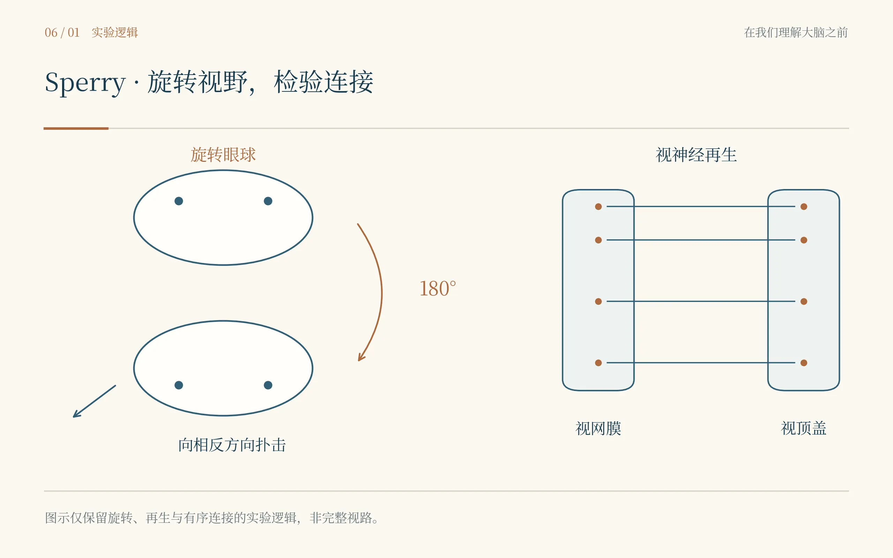
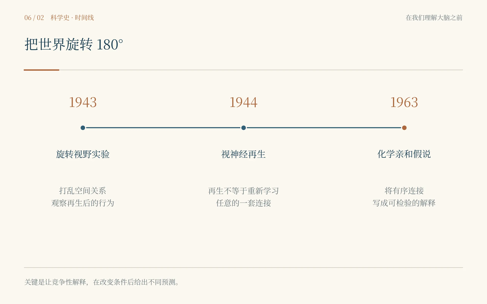

# 第六章　倒过来的世界

*Roger Sperry：神经元怎么知道自己该连到哪里？*

诱饵明明在青蛙右前方，它却猛地朝左后方扑了过去。舌头伸出去，撞在空荡荡的木板上。那一下很响，我甚至下意识往后退了半步。青蛙自己似乎也愣了一瞬，随后重新蹲好，眼睛一鼓一鼓地盯着前面。站在桌边的男人没有笑，也没有安慰它。他只是把细铁丝末端的小虫模型移到另一个方向，等了几秒，再试一次。

结果还是错。诱饵在上，它往下扑；诱饵在前，它转向后面。不是偶尔失误，而像整个视觉世界被一只看不见的手翻转了一百八十度。我看着那只青蛙反复扑空，第一反应竟然不是“这就是Sperry的实验”，而是觉得有点残忍。一个动物明明看见了东西，却永远在错误的方向上做出正确的动作。

“它会学回来吗？”我问。那个男人抬起头。他很年轻，脸窄，表情安静得近乎冷淡，说话时也不急着和我对视。“目前没有。”他说。桌上的笔记写着1943年。我这才把眼前这张还没有后来那么著名的脸和名字对上：Roger Wolcott Sperry。

我在2026年读到“神经可塑性”时，几乎习惯性地把它理解成一种乐观能力。大脑会适应，会重组，会在损伤后寻找替代通路；训练会改变连接，经验会塑造回路。这样的语言太常见，以至于我第一次看到Sperry这只青蛙时，本能地认为它只需要更多时间。世界倒了，大脑慢慢转回来就好。Sperry却没有被这种直觉打动。他已经让动物经历了足够多的视觉经验，错误仍旧顽固地保留下来。

问题出在那只眼睛。更准确地说，出在“眼睛和脑之间的关系”。在实验之前，Sperry把眼球在眼眶里旋转了一百八十度，同时切断视神经。对哺乳动物来说，这样的切断往往意味着永久损伤；但在蛙和蝾螈等较低等脊椎动物中，视神经轴突具有显著再生能力。几周乃至更长时间以后，新的轴突会重新长向中脑的视顶盖，视觉功能逐渐恢复。真正的问题不是它们能不能长，而是它们会长到哪里。

如果再生轴突只是在视顶盖里随便找到位置，然后由经验把新的连接“训练”成有用的系统，那么旋转眼球之后，动物最终应该能够重新校准。眼睛虽然倒了，脑只要慢慢学习“现在这个位置代表那个方向”，行为就可能恢复正常。可如果每一根来自特定视网膜位置的轴突都带着某种固定的身份，并倾向于回到自己原先的脑内目标，那么旋转眼球后，再生连接反而会忠实地恢复“旧地图”。地图本身没错，眼睛的坐标却被人为翻转，于是行为会稳定地错下去。

Sperry真正做的，并不是简单观察动物恢复得好不好。他人为制造了一个世界，在这个世界里，两种理论必须给出相反的答案。看上去只是把眼球转了一百八十度，实际上是把一个模糊争论切成了可以被行为结果裁决的两条路。

我突然理解为什么这类实验读起来会让人有一种“太简单了”的错觉。真正好的实验，常常不是装置复杂，而是逻辑锋利。它会把自然条件下混在一起的可能性拆开，逼迫每个解释提前下注。等结果出来，至少有一个解释必须付出代价。

“再试前面。”Sperry说。我把诱饵移到青蛙正前方。它停了几秒，突然整个身体向后扭，朝着完全相反的方向扑去。Sperry在纸上记了一笔，没有任何戏剧性的表情。我忍不住说：“这已经很明显了。”他仍然没有停笔，只回答：“明显和稳定不是一回事。”

这句话让我想起Cajal，也想起Hodgkin。Cajal看到漂亮切片时先怀疑切片；Hodgkin看到动作电位越过零时先怀疑液接电位；现在Sperry看着几乎像教科书插图一样整齐的反向行为，第一件事依然是继续测。穿越到这里以后，我越来越不相信“伟大发现发生时，科学家会立刻知道自己发现了伟大东西”这种想象。更多时候，他们只是比别人多做了几次确认。

实验室里的Sperry和我预想的不太一样。他不像Loewi那样容易被一个结果点燃，也不像Rita那样有明显的锋芒。他的安静甚至有些难以接近。和他说话时，我常常不知道他是没听见，还是正在把一句话拆成几个更精确的问题。有一次我问：“你是不是觉得神经系统天生就写好了？”他沉默了几秒，说：“我只觉得‘什么都可以通过学习纠正’这个说法太便宜。”

“便宜？”我问。

“因为它几乎可以解释所有结果。”他说，“连接对了，是学习；连接错了后来变好了，也是学习；连接错了没变好，还可以说学习不够。一个理论如果永远不会输，就很难知道它究竟说了什么。”

这句话让我有点不舒服，因为它太像我们今天某些宏大的解释。一个模型如果任何方向的结果都能事后合理化，它看上去覆盖面很广，真正可检验的内容却可能很少。科研写作很容易奖励“解释力”，却不总奖励“愿意承担失败风险的预测”。

Sperry早在做这只青蛙之前，就已经对“神经连接是否可以随意重排”产生怀疑。他曾在大鼠上交换支配不同肌肉或不同皮肤区域的神经。按最乐观的适应观点，动物也许会逐渐学会使用被重新接线的肢体。但许多情况下，错误反射和不合适的动作模式会顽固存在。系统并没有表现出无限自由的重新组织能力。

这并不是说经验不重要，也不是说神经系统完全不能改变。真正被削弱的是一种更极端的想法：只要神经接上，功能关系就可以主要靠使用慢慢训练出来。Sperry看到的是另一幅图景——连接的“身份”似乎比想象中更具体。

我问他：“那轴突怎么知道自己的位置？”这一次他没有马上回答。桌上的蛙还在缓慢呼吸，视神经已经重新长过了那段曾经被切断的距离。如果每一根轴突真的回到了某个特定区域，里面一定存在某种导航信息。可在1943年，没人能把这种信息指给我看。没有荧光标记的ephrin，没有受体梯度，没有单细胞空间转录组。只有行为错误，以及由行为反推出来的一张看不见的地图。

“它们必须彼此不同。”Sperry最后说，“如果所有纤维都一样，就没有理由总是回到相近的位置。”

“不同在哪里？”

“这就是下一步。”

我忽然发现，Rita给我的答案在这里被拆成了两半。NGF解决的是“神经元有没有机会活下去、长出去”；Sperry追问的是“长出去以后往哪儿走、和谁接”。生长和导航不是同一个过程。一个细胞可以活得很好，却把线接到完全错误的地方。

这对我自己的研究也有一种奇怪的提醒。我们常常看到某种生物学变化后就迅速把它纳入一条单线因果链：某分子升高，所以某细胞功能增强，所以某回路改变。可真实系统往往把“数量”“存活”“位置”“连接”“功能”分成多个不同层次。一个层次的变化不能自动替另一个层次回答问题。

***

几年之后，我在另一个时间点又见到了Sperry。地点已经不是那间摆着青蛙和诱饵的实验室，而是加州。桌上的图更抽象了：视网膜的一端对应视顶盖的一端，另一端对应另一端，像两张彼此配准的坐标纸。Sperry开始用一种后来会变得著名的语言来描述这种精确连接——不同位置的神经元可能携带不同的化学“标签”，生长中的轴突依据互补关系选择目标。

后来，这套想法被概括为chemoaffinity hypothesis，化学亲和假说。它并不意味着Sperry已经知道具体分子。事实上，真正参与视网膜—视顶盖定位的分子梯度和受体体系还要等后来的发育神经生物学去逐步揭开。Sperry做的，是在分子证据出现之前，先用行为和再生实验把“这里应该存在某种位置编码”这个问题钉在墙上。

我以前总以为机制研究应该按顺序进行：先找到分子，再知道功能。可科学史一次次告诉我，顺序经常相反。你可能先看到一个行为规律，接着推断回路原则，再过几十年才找到承担它的分子。不同尺度并不是排队等待，而是在相互逼近。

“你是在给神经元分配地址。”我看着那张拓扑图说。Sperry摇了摇头：“不是我分配。我要知道的是，它们是不是已经有地址。”这句话后来一直留在我的笔记里。现代组学很擅长给细胞分类：某种细胞表达什么基因，属于什么亚群。但分类不等于组织。真正的大脑还要求这些细胞出现在特定位置、连接特定对象，并在时间上以特定方式活动。身份只是开始。

我原以为Sperry会因为这套“接线”工作获得诺贝尔奖。可1981年的诺贝尔奖名单真正出现时，获奖理由却是另一件事：Roger Sperry因“大脑半球功能专门化”的发现获得一半奖金，David Hubel和Torsten Wiesel共同分享另外一半，表彰视觉系统的信息处理。那一刻我第一次意识到，一个科学家最重要的早期工作和最终写在诺奖证书上的那句话，完全可以不是同一件事。\[6.5\]

这反而让我更喜欢Sperry。因为如果把科研人生写成“某人做了一个诺奖工作，然后领奖”，就会错过真正的连续性。早年他问的是：神经连接有没有固定的组织原则？后来他问：两个半球被分开以后，功能和意识会怎样重新显露？表面上问题变了，底下仍然是同一件事——系统的组织方式如何决定行为。

我知道自己以后还会见到他。只是现在还不是时候。

离开加州之前，我把自己这一路的笔记重新翻了一遍。Cajal把神经系统拆成独立细胞；Sherrington让我看见整合；Loewi证明突触可以借化学物质传递；Hodgkin和Huxley把电信号拆成离子过程；Rita与Cohen让我看到神经元如何得到生长和存活的支持；Sperry则第一次把“连接位置”变成了可以实验操纵的问题。

接下来，一个更大的问题已经无法回避。即使每根神经纤维都找到了相对正确的目标，几十亿个细胞最后组成的大脑是不是仍然只是均匀的一团组织？还是说，不同位置从一开始就承担不同的工作？

这个问题看起来像一张地图。可人类最早画这张地图时，并没有fMRI，也没有电极阵列。只有病人。

空气里忽然出现一股医院里才有的味道。我听见有人艰难地重复同一个音节。

“Tan。”

---

## 史实与创作说明

1943年Sperry发表“Effect of 180 degree rotation of the retinal field on visuomotor coordination”。在蛙/蝾螈等可发生视神经再生的动物中，他将眼球旋转180°并让切断的视神经再生，动物恢复视觉后仍持续朝与实际诱饵相反的方向扑击。后续视网膜—视顶盖研究推动他提出化学亲和假说：不同位置的轴突和目标可能具有位置依赖的分子识别信息。1981年Sperry获得诺贝尔生理学或医学奖的一半，但正式获奖理由是大脑半球功能专门化，而非化学亲和工作。

学习线索：设计能让竞争理论产生不同预测的干预，并提前说明哪些结果会推翻各自解释。正常状态下的共同拟合，不足以区分机制。

## 本章插图

{fig-align="center" width="90%"}

{fig-align="center" width="90%"}

## 本章参考文献

- [6.1] Sperry RW. Effect of 180 degree rotation of the retinal field on visuomotor coordination. J Exp Zool. 1943;92(3):263–279. doi:10.1002/jez.1400920303.
- [6.2] Sperry RW. Optic nerve regeneration with return of vision in anurans. J Neurophysiol. 1944;7:57–69.
- [6.3] Sperry RW. Chemoaffinity in the orderly growth of nerve fiber patterns and connections. Proc Natl Acad Sci USA. 1963;50(4):703–710. doi:10.1073/pnas.50.4.703.
- [6.4] Attardi DG, Sperry RW. Preferential selection of central pathways by regenerating optic fibers. Exp Neurol. 1963;7:46–64.
- [6.5] Nobel Prize. The Nobel Prize in Physiology or Medicine 1981: Roger W. Sperry; David H. Hubel; Torsten N. Wiesel.
- [6.6] Sperry RW. Nobel Prize materials on cerebral hemispheric specialization. Nobel Foundation; 1981.
