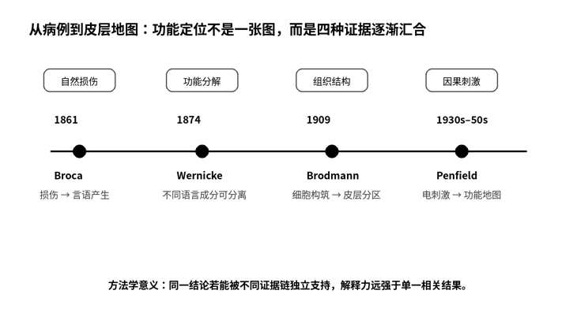

# 第七章　一个叫Tan的人

*Broca × Wernicke × Brodmann × Penfield：大脑里有没有一张地图？*

病床上的男人已经说不出完整的话很多年了。有人问他名字，他张开嘴，舌头和嘴唇都能动，却只挤出一个短促的音：“Tan。”再问年龄，还是“Tan”。问他哪里痛，他皱起眉，用左手指向已经严重坏死的右腿，嘴里依旧是那一个音。那不是一个什么都不懂的人。他会点头，会摇头，会因为别人误解自己而明显烦躁，甚至会用表情和手势把意思表达得很清楚。只是当思想试图变成有结构的语言时，通道像在某个地方断了。

1861年，巴黎Bicêtre医院。这个病人的名字是Louis Victor Leborgne，可后来的神经科学史更记得他的绰号：Tan。

站在床边的Paul Broca看起来不像我印象中那种只盯着一个问题几十年的科学家。他是外科医生、解剖学家，也积极参加当时的人类学讨论，兴趣广得近乎危险。那天他真正被吸引的，是一个当时仍充满争议的问题：复杂心理功能能不能和大脑的特定部位建立稳定关系。

我在未来当然知道答案会被写成“Broca区”。可真正站在病床边，那个词突然显得过分干净。Leborgne不是一道定位题。他在医院里生活了二十多年，言语能力几乎完全丧失，后来又出现右侧瘫痪，最后因为严重感染和坏疽被送到外科病房。所谓“经典病例”的另一面，是一个人在漫长疾病里失去越来越多东西。

Broca的检查比我想象中细。他会判断Leborgne是否理解指令，观察舌和面部运动，确认听觉反应，区分“不会说”究竟是因为肌肉瘫痪、智力严重受损，还是更特异的言语表达障碍。今天我们把这种过程叫神经心理评估，在当时却没有标准化量表，更没有结构MRI帮你提前看到病灶。能做的，是尽可能把一个复杂缺陷拆成不同可能。

“他理解你。”我说。Broca点了一下头，但没有因为这句话就得出更大的结论。“理解某句话”和“保持全部语言能力”不是同一个判断。他特别警惕把“言语”这个词说得太大。Leborgne损失的核心更接近有意形成清晰、可发音语言的能力，而不是所有思想、所有理解和所有交流。

这点后来常常在简化叙事里被丢掉。人们喜欢说Broca发现了“语言中心”，仿佛一个核桃大小的区域装着整套语言。真正的历史更谨慎：病灶提示左额叶某一部分对言语表达至关重要，但从一个病人的损伤，不能自动推出语言只有一个位置，更不能说明那个区域单独完成了全部语言加工。

Leborgne去世后，真正让科学史发生变化的场景出现在解剖室。Broca检查大脑，在左侧额叶后部发现显著病变。对我而言，那块组织最令人震撼的不是“位置终于对上了”，而是这是一种特殊的自然实验：疾病替研究者完成了一个永远不可能在健康人身上随意实施的局部破坏，而病人的行为缺失反过来暴露了某个区域可能承担的功能。

可自然实验也有天然缺陷。病灶并不一定只局限于一小块，疾病会扩展，长期损伤会导致整个网络重组，患者本身也不是经过随机分组得到的样本。后来我做影像统计时总喜欢把病灶研究想成“因果证据”，站在那间解剖室里才更清楚地意识到：它确实比单纯相关更接近因果，却仍然需要谨慎。因果不是一个标签，而是一条需要不断排除替代解释的证据链。

几天后，Broca在巴黎人类学学会报告这个病例。历史后来赋予那次报告极高地位，可当时它并没有让整个欧洲立刻停下来宣布“语言已经被定位”。科学共识很少在一个下午形成。真正的影响来自后续病例不断积累，也来自其他人发现：语言本身还能继续被拆开。

***

十三年以后，我站在德国一间完全不同的病房里。病人说得很多，甚至多得让我一开始怀疑她是不是根本没有障碍。语速自然，句子长度也足够，可词语之间的关系像被悄悄打乱。更奇怪的是，当医生给出一个简单口头指令时，她并不能稳定理解。

“她不是说不出来。”我说。年轻的Carl Wernicke正在记笔记。“问题在另一边。”

Wernicke比Broca更像一个理论家。Broca从一个病人的缺失出发，把功能拉回到解剖；Wernicke则试图把不同类型的语言障碍组织成一套系统。他注意到，有些患者言语流利却缺乏有效理解，这意味着“产生言语”和“理解言语”至少可以相对分离。1874年，他在关于失语症的著作中描述了后来被称为感觉性失语的综合征，并进一步思考不同语言区域之间的连接。

这一步非常重要。因为一旦承认语言不是一个不可拆分的整体，大脑地图就不再只是“哪个地方负责语言”，而开始变成“哪些部分各自处理不同成分，它们怎样连接起来”。从中心到连接，神经心理学第一次带上了网络味道。

我问Wernicke：“如果一个区域负责理解，另一个区域负责表达，那是不是把它们连起来就够了？”他看了我一眼，像觉得这个问题问得过分现代。“你为什么假设只有两个？”

我一下没接上话。

那句反问后来一直留在我脑子里。科研最大的诱惑之一，是把刚刚拆开的复杂问题重新压缩成一个过于整齐的模型。Broca让我们知道表达可能有关键节点，Wernicke让我们看到理解和连接也有独立贡献，可这并不意味着真实语言系统只有两个盒子和一条线。模型的价值在于提供可检验的近似，不在于把近似当成世界本身。

如果说Broca和Wernicke是从“功能缺失”反推位置，那么下一站的人几乎反过来。他不先问患者失去了什么，而先问：大脑皮层本身是不是就存在结构不同的区域。

***

1909年的柏林没有病房里的呻吟，也没有外科器械碰撞声。Korbinian Brodmann的桌上只有一排排脑组织切片。染色后的皮层像一层层深浅不同的地质断面。对未经训练的眼睛来说，它们差不多；对Brodmann来说，不同区域的皮层厚度、细胞密度、颗粒层、锥体细胞分布都在发生系统变化。

我第一次看到他画出的数字时，有一种很怪的熟悉感。17、18、44、45……这些号码在2026年的脑影像论文里仍然活着。我们会写BA17是初级视觉皮层，BA44/45与语言相关，仿佛它们从大脑出生时就带着编号。其实这些数字只是一个二十世纪初的研究者为了描述细胞构筑差异而建立的地图。

Brodmann并不是拿着功能实验给每块皮层命名。他主要依据cytoarchitecture，也就是细胞构筑，把皮层划分为一系列区域。最容易被后人误读的地方，是把“结构不同”直接等同于“功能不同”。Brodmann本人没有这么简单。他真正感兴趣的是，稳定的组织学边界是否可能对应功能分化，但他同样知道复杂心理活动不能轻率塞进一个个孤立小区。

“你为什么给它们编号，不直接写功能？”我问。他把一张切片转了个方向。“因为功能还没那么清楚。”

“以后人们会给这些数字加很多功能。”

“那是以后的证据。”他说。

我很喜欢这句回答。分类系统最危险的时刻，往往不是它被发明时，而是使用者忘记了分类依据。一个脑区模板可以基于细胞结构、沟回解剖、功能连接、任务激活或数据驱动聚类。不同分区并不是“谁更正确”的简单竞争，而是在回答不同层次的问题。今天我们把某个统计结果映射到一个模板时，实际上已经偷偷接受了那个模板对大脑边界的假设。

Brodmann的地图让“大脑不是均匀组织”这件事更加具体。但结构地图仍然不等于功能地图。真正让“活着的人类皮层”开始回答问题的，是几十年后的手术室。

***

我再次睁眼时，第一眼看见的是人的大脑。不是MRI，不是固定后的标本，也不是教科书插图。灰白色的皮层在手术灯下轻微起伏，表面血管像细小的红色河流。患者清醒着。她能听见我们说话，也能回答问题。

我下意识觉得这不可能不疼。Wilder Penfield却像提前知道我的疑问似的解释，手术需要对头皮和其他疼痛敏感结构进行局部麻醉，但脑组织本身并没有和皮肤一样的痛觉感受能力。保持患者清醒有一个极现实的目的：外科医生可以一边刺激皮层，一边让患者报告感觉、运动和语言变化，从而尽量避免切除重要功能区。

这里是蒙特利尔神经研究所。Penfield的动作和我见过的实验生理学家都不同。他是外科医生，决定一旦做出就不能像数据分析那样按Ctrl+Z。也许正因为如此，他讲话非常稳。刺激电极接触到一小块皮层时，他会先告诉患者可能出现什么，再观察反应。一个位置被刺激后，患者右手手指突然动了一下。另一个位置，患者报告嘴角有奇怪的感觉。

“她是自己动的吗？”我问。Penfield摇头。再刺激一次，手指又动了。病人自己也笑起来，说并不是她想动。那一刻我第一次如此直接地看到“意志”和“运动输出”可以被分开：一个人没有做出动作的意图，某段皮层受到刺激以后，肌肉仍然执行了动作。

随着多年手术积累，Penfield和同事把大量刺激位置与身体反应对应起来。手、面、舌、腿并不是按照真实身体比例整齐排列在皮层上。某些精细感觉和运动需要更大的皮层代表区域，于是著名的“皮层小人”被画成一个嘴唇巨大、双手夸张的人形。它很怪，却把一个核心思想说得非常直观：皮层资源分配反映功能需求，而不是身体几何尺寸。

更令人不安的是颞叶刺激。有些患者在特定刺激下报告极其生动的声音、音乐、场景或似乎来自过去的体验。Penfield非常谨慎地记录这些现象，不把每一次主观报告都当成完整的“记忆存储点”。可对站在旁边的我来说，只要一次就足够震撼：一个极小的电流落在皮层上，人的内部世界突然多出一个别人看不见的场景。

我终于明白“脑功能定位”为什么会让十九、二十世纪的科学家如此着迷。它像一种巨大的承诺：如果损伤、结构边界和电刺激都能把某些功能反复指向特定区域，那么思想、语言、动作、感觉这些看似无形的东西，也许真的能被放回物质的大脑。

可同一间手术室也让我看见定位论的边界。患者说一句完整的话，需要听觉、语言理解、词汇提取、发音计划、面口运动和注意等多种过程协作。刺激一个小区域可以让其中某一环短暂失败，却不意味着“整句话”住在那个点里。地图越精细，我反而越不愿意把复杂功能压缩成一个坐标。

有一次手术结束后，我问Penfield：“如果我把每一种功能都找到位置，是不是就理解大脑了？”他正摘手套，停了一下。“你能在地图上找到所有城市，”他说，“但那不等于你知道一座城市每天在做什么。”

我记住的不是那幅地图，而是手术台旁一阵短暂的安静。地图上可以标出一座城市，可从一个地名推测整座城市每天怎样生活，仍然太快了。我们能够较准确地指出一个脑区的位置，却不能因此说清它在怎样处理信息。

***

那天晚上，我把自己从1861到二十世纪中叶的笔记摊在桌上，忽然发现这章真正画出的不是一张“脑区地图”，而是一套方法。Broca用自然损伤寻找必要节点；Wernicke通过不同症状的分离，把一个巨大功能拆成组件；Brodmann从组织结构建立可重复的空间边界；Penfield则直接扰动活着的皮层，看行为和体验怎样改变。

四种方法都不完美。病灶可能太大，症状分解可能过度简化，组织边界不必然等于功能边界，电刺激也会影响局部网络而不只是单个点。但当不同证据从不同方向收敛时，我们对一个结论的信心才真正增加。

这比“某项研究P值显著”难得多，也比“某脑区在一张图上亮起来”更有力量。证据的数量并不等于证据链的多样性。十个相关分析可能仍然只是同一种证据；而病灶、刺激、解剖和单细胞记录即使样本不同，却可能共同围住一个机制。

我想起自己最初那张功能连接图。导师问“然后呢”，我当时以为他只是希望我多做几个机制分析。现在我开始怀疑，他问的也许是另一件事：你知道差异在哪里了，可这个位置到底在处理什么信息？

知道“视觉皮层在枕叶”，并不等于知道视觉皮层为什么能让我们看见一条线。

手术室里那盏灯突然熄灭。黑暗里先出现一个很轻的噪声，随后是扬声器里稀疏的脉冲。有人把一个小光点投到猫的视网膜上。扬声器没有反应。又换一个位置，仍然没有反应。

我听见一个人用带笑意的语气说：“也许它根本不喜欢我们的点。”

---

## 史实与创作说明

1861年Paul Broca报告Louis Victor Leborgne（“Tan”）病例，并将严重言语产生障碍与左额叶后部病变联系起来。1874年Carl Wernicke描述另一类以语言理解受损和流利但无效言语为特征的失语综合征，并推进了语言区域与连接的模型。Korbinian Brodmann在1909年系统总结基于细胞构筑的皮层分区；Wilder Penfield则在蒙特利尔通过清醒开颅和皮层电刺激，在治疗癫痫的同时积累了运动、感觉、语言及部分体验性反应的功能定位资料。

本章的学习线索是“问题分解—多证据收敛—地图不等于机制”。复杂概念如语言、记忆、情绪不能直接作为单一机制处理，需要拆成可测量的组成过程。病灶、组织学、刺激和现代成像各有偏差；真正可靠的结论往往来自不同证据类型相互支持。定位回答where，但不能自动回答区域内部如何处理信息。

## 本章插图

{fig-align="center" width="90%"}

{fig-align="center" width="90%"}

## 本章参考文献

- [7.1] Broca P. Remarques sur le siège de la faculté du langage articulé, suivies d’une observation d’aphémie. Bulletin de la Société Anatomique de Paris. 1861.
- [7.2] Wernicke C. Der aphasische Symptomencomplex: Eine psychologische Studie auf anatomischer Basis. Breslau: Cohn & Weigert; 1874.
- [7.3] Brodmann K. Vergleichende Lokalisationslehre der Grosshirnrinde in ihren Prinzipien dargestellt auf Grund des Zellenbaues. Leipzig: Barth; 1909.
- [7.4] Penfield W, Boldrey E. Somatic motor and sensory representation in the cerebral cortex of man as studied by electrical stimulation. Brain. 1937;60(4):389–443. doi:10.1093/brain/60.4.389.
- [7.5] Penfield W, Rasmussen T. The Cerebral Cortex of Man: A Clinical Study of Localization of Function. New York: Macmillan; 1950.
- [7.6] Dronkers NF, Plaisant O, Iba-Zizen MT, Cabanis EA. Paul Broca’s historic cases: high resolution MR imaging of the brains of Leborgne and Lelong. Brain. 2007;130:1432–1441.

> **插图说明：** 原稿的实验示意图正在进行公开传播权利核验，当前网页仅发布正文与参考文献。
