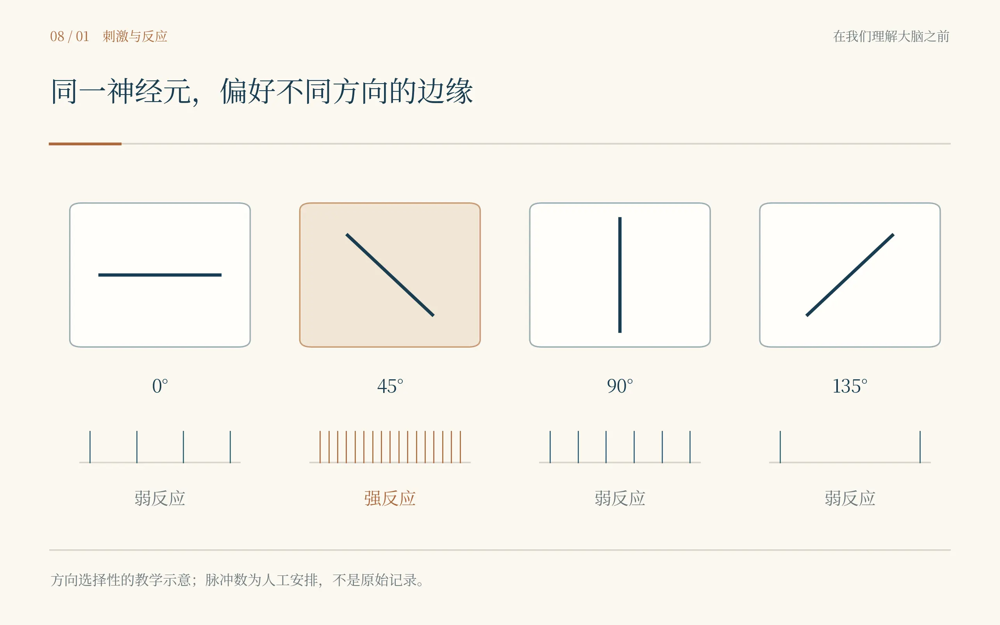
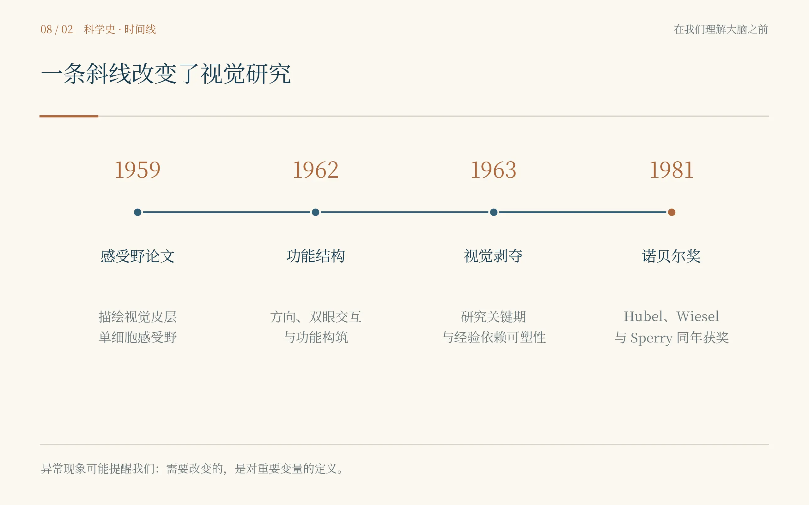

# 第八章　一条斜线

*Hubel × Wiesel：大脑不是照相机，它在计算世界*

扬声器里仍然没有传来放电声。房间的遮光帘拉得很紧，只有仪器的指示灯和投影的一小片亮点，像两处不肯睡去的眼睛。1958年的约翰斯·霍普金斯，Hubel和Wiesel守着一根插入视觉皮层的微电极，听扬声器里有没有神经脉冲。我把手插进口袋，不敢告诉他们：几十年以后，教科书会把这间阴暗的实验室印成神经科学最明亮的一页。

David Hubel正在调电极。他有一种明显的器械癖。很多人面对坏掉的装置会先找技术员，他更像那种会先拆开看看里面到底为什么坏的人。此前在Walter Reed工作时，他已经改进过用于单细胞记录的微电极和推进装置。Torsten Wiesel站在另一侧，检查视觉刺激的位置。和Hubel相比，他给我的第一印象更平稳，更善于把注意力留在生物学问题上，而不是立刻被装置本身吸走。

两个人并不是经过多年规划才组成“诺奖搭档”。Hubel本来准备去Vernon Mountcastle的实验室，但实验室恰好装修，Stephen Kuffler让他暂时和已经在Wilmer工作的Wiesel合作。一个原本像过渡安排的决定，最后持续了二十多年。科研史里有些合作看起来像命中注定，真正发生时可能只是“你的房间现在还不能用，要不先和他一起做几个月”。

他们当时的问题并不神秘：视网膜和外侧膝状体的神经元对光斑已经有相当清楚的反应规律，那么再往上一级，视觉皮层里的单个神经元究竟喜欢什么？直觉上，最自然的做法就是继续用简单的亮点和暗点去探。

结果非常挫败。光点移来移去，很多细胞几乎没有稳定反应。换大小，换位置，换亮度，扬声器依旧安静。做过单细胞实验的人会知道这种安静多么折磨人：你无法立刻判断“细胞对刺激不响应”是一个生物学事实，还是麻醉深度不合适、电极没在正确位置、刺激没有落在感受野、细胞已经受损，或者整个装置里某根线接触不好。

“再找一次感受野。”Wiesel说。Hubel调整刺激。还是没什么。几小时过去，猫没有给他们任何“即将改变神经科学”的暗示。

我越来越焦躁，甚至开始替他们排故障：先确认电极，再看眼位，再校准投影位置。Hubel倒没有显得失望。他一边移动玻璃片，一边听扬声器。就在某一次把黑色圆点所在的玻片推进检眼镜时，玻片的边缘意外扫过视网膜。

扬声器突然炸开了。

不是一两个脉冲，而是一串像机关枪一样密集的放电。

房间里三个人几乎同时停住。Hubel先把玻片退回去，又慢慢推进。那条边缘再次经过某个位置时，扬声器又响。Wiesel没有说“成功了”，而是马上问：“刚才到底是什么刺激？”

他们很快发现，真正有效的不是圆点本身，而是玻片边缘形成的一条细长阴影。更奇怪的是，线条角度稍微改变，反应就显著减弱；转到某个特定方向时，这个神经元几乎像被打开了开关。

我当然知道这叫orientation selectivity，方向选择性。可当一个概念还没有名字时，看见它第一次从噪声里长出来，和在教材里读到它完全是两回事。教材会画四根不同角度的线，再配几条放电曲线，让结论看上去像设计好的课堂演示。真实实验里，最先出现的是几小时“不工作”的刺激，以及一块玻璃片移动时留下的意外边缘。

“所以它不是不响应。”我说，“是我们一直没问对问题。”Hubel笑了一下：“这两件事在实验室里经常长得很像。”

这句话对我打击很大。组学和脑影像时代，我们拥有极多变量，常见做法是把能测的都测出来，再寻找显著关系。Hubel和Wiesel这里恰恰相反：真正的突破来自找到“这个细胞把什么变量当成重要维度”。光强不是唯一问题，空间位置不是唯一问题，边缘的方向本身就是一个被编码的特征。

我又把那一串放电听了一遍。它不是给一个神经元贴标签，说“这个细胞负责斜线”。更准确的说法是：在一定条件下，这个细胞的放电概率对某类输入特征有系统选择性。要证明这一点，就需要改变刺激维度，测量响应函数，并确认这种选择性在不同细胞和不同位置具有可重复结构。

Hubel和Wiesel开始系统旋转线条。水平，倾斜，垂直，再倾斜。某些细胞只在狭窄方向范围内强烈放电；有些细胞不仅关心方向，也关心线条在特定位置出现；另一些所谓复杂细胞对位置更宽容，却仍然偏好特定方向和运动。视觉皮层不再像一块只负责“接收视觉”的区域，而像一个逐层提取结构的计算系统。

我想到第七章里那句“知道城市在哪里，不等于知道城市每天在做什么”。Hubel和Wiesel现在做的，正是试图进入城市内部。V1在枕叶这个事实本身没有消失，但问题从“哪里”推进到“变换”：输入到达这一层以后，被怎样重新表示？

***

如果故事只停在“发现方向选择性”，仍然低估了他们后来的工作。随着记录不断积累，他们发现视觉皮层具有惊人的空间组织。偏好相似方向的细胞并不是完全随机散落；沿着皮层移动电极，最佳方向会以某种有序方式变化。来自左右眼的输入也形成规律性的优势分布。后来，“orientation columns”和“ocular dominance columns”成为视觉皮层组织的经典概念。

我第一次看到这些柱状结构示意图时，脑子里出现了一个词：模块。局部皮层像在重复布置一套小型计算单元，每个位置需要同时保留不同方向信息、双眼信息和视野位置。Hubel在后来诺奖演讲里把这种局部组织形容成处理特定视野位置和特征的小机器。那并不意味着大脑真的由一模一样的硬件模块拼起来，而是说明“空间组织本身可能就是计算的一部分”。

这件事对今天做脑网络的人尤其重要。我们很容易把“网络结构”和“功能”分开写：先算拓扑，再讨论行为。可神经系统里，结构经常就是计算约束。谁和谁更容易连接，信息从哪一层到哪一层，局部横向连接能走多远，都会决定一个回路能够实现什么变换。

更漂亮的是，Hubel和Wiesel并没有因为发现有序结构就走向“全部天生固定”的极端。相反，他们很快把问题推进到发育：这种视觉皮层组织出生时就已经完成了吗？经验在什么时候可以改变它？

这一次，我立刻想到Sperry。Sperry的旋转眼球实验告诉我，神经连接并不是随意搭好以后靠经验无限重学。可Hubel和Wiesel后来关于视觉剥夺的实验又清楚表明，早期经验能够深刻塑造皮层。幼年动物在关键发育窗口中，如果一只眼长期得不到正常视觉输入，对应的皮层代表会显著减弱，另一只眼的输入占据更多资源。

两组发现看上去像在打架，其实它们把问题变得更精确了。神经系统既不是完全预先写死的电路，也不是一张任何连接都能靠经验重写的白纸。发育先提供结构约束和初步地图，经验在特定时间窗内选择、加强、削弱和精细化这些连接。真正重要的问题从“先天还是后天”变成“哪些部分由什么机制预设，哪些部分在什么时间范围内对经验开放”。

这种从二选一走向条件化问题的过程，也是一种科研成熟。很多争论之所以持续，是因为问题问得太粗：遗传还是环境？局部还是网络？结构还是功能？微生物还是宿主？真正可以实验回答的问题通常要加上时间、尺度和条件：在什么阶段、什么组织、什么扰动强度下，哪一部分变异主要由哪个机制解释。

Hubel和Wiesel的合作也越来越让我着迷。两个人共同工作二十多年，却很难把所有想法精确分配给某一个人。Hubel后来回忆，很多念头是在讨论里同时形成的，有时一个人说过，另一个人过几天又重新提出来，谁最先想到反而不再重要。这样的合作和“贡献百分比”之间存在一种天然张力。现代科研需要明确署名和责任，这是必要的；可真正好的合作又常常会把思想揉到难以拆分。

我问他们有没有争过谁的想法。Wiesel笑了，说当然会争，但更常见的争论是某个细胞到底算哪一类、某个模型是不是太漂亮、某个结果值不值得再多做一只动物。Hubel补了一句：“如果我们花时间争谁先想到，就没时间知道它是不是对的。”

二十多年里，坏掉的仪器和失败的记录在两人之间来回。谁先发现问题，并不总是记得清；下一次实验要改哪里，他们却都知道。看着他们交换那张记录纸，我才觉得“合作”这个词有了分量。

***

1981年12月，斯德哥尔摩。

我已经不止一次来到这座城市。第一次看Golgi和Cajal共享一个奖却坚持相反解释；后来见过别的获奖者在几十年后重新回看年轻时做过的实验。可这一次对我特别奇怪，因为台上的三个名字，我已经在不同年代分别见过。

这一年的生理学或医学奖，一半授予Roger Sperry，表彰他关于大脑半球功能专门化的发现；另一半由David Hubel和Torsten Wiesel共同分享，表彰他们关于视觉系统信息处理的发现。按奖金份额算，Sperry是一半，Hubel和Wiesel各四分之一。

Sperry因为健康原因没有亲自完成自己的诺贝尔演讲，演讲由诺贝尔委员会成员代读。我坐在会场里听到他的名字时，脑海里却先出现了1943年那只永远朝错误方向扑击的青蛙。诺奖证书没有写“旋转眼球”，没有写“化学亲和”。可没有那些早期实验，我很难想象后来那个不断追问系统组织原则的Sperry。

Hubel的演讲则更像一次对二十多年实验思路的回看。他没有把视觉皮层描述成一张静态地图，而是不断讲细胞反应、感受野、柱状结构和信息逐步变换。Wiesel的部分特别强调发育和经验。三个人的工作被放在同一个奖项年份里，像是无意中组成了一句话：连接有组织原则，皮层有计算结构，而经验能够在特定阶段改变这套结构。

晚宴灯光很亮。我看着Hubel和Wiesel坐在人群里，突然想起他们最初那间没有窗的地下实验室。那时一只猫的视觉皮层对圆点几乎不理不睬，谁也不知道一块玻璃片的边缘会把问题改写。二十多年后的奖章并没有让那个瞬间更“必然”。如果当时他们只是记录一句“无反应”，换下一只动物，也许历史会晚一点。

我在笔记本上写：一次没有反应的实验，可能是装置出了问题，也可能是刺激并没有碰到细胞真正关心的东西。两种解释必须用下一次实验分开。

写完以后，我停了一会儿，又在旁边补了一句：知道某个脑区亮起来，只是where；知道某类细胞对什么特征响应，才开始接近what；真正的how，还要继续往下走。

我想起离开实验室前，导师留下的那三个字。“然后呢？”当时我觉得那是对结果的不满意。现在我第一次听懂了一点。他不是让我把图做得更多。他是在问：这张图里的大脑，到底在计算什么？

---

## 史实与创作说明

1958年David Hubel与Torsten Wiesel在Johns Hopkins开始长期合作，1959年发表猫纹状皮层单神经元感受野经典论文。早期实验中，普通光点常不能有效驱动某些皮层神经元；移动刺激玻片时形成的边缘意外引起强烈放电，促使他们系统发现视觉皮层神经元对线条方向、位置和运动等特征具有选择性，并进一步描述方向柱、眼优势柱及视觉发育关键期。1981年二人与Roger Sperry共同分享诺贝尔生理学或医学奖，Hubel和Wiesel的获奖理由为视觉系统信息处理。

本章的学习线索是“从无反应中重新定义变量”。数据不符合预期时，首先要排除技术错误；若技术可靠，则应考虑系统真正编码的变量可能不同于实验者最初设定的变量。科学发现不仅来自得到强信号，也来自理解为什么在你以为应该有信号的地方没有信号。

## 本章插图

{fig-align="center" width="90%"}

{fig-align="center" width="90%"}

## 本章参考文献

- [8.1] Hubel DH, Wiesel TN. Receptive fields of single neurones in the cat’s striate cortex. J Physiol. 1959;148(3):574–591. doi:10.1113/jphysiol.1959.sp006308.
- [8.2] Hubel DH, Wiesel TN. Receptive fields, binocular interaction and functional architecture in the cat’s visual cortex. J Physiol. 1962;160(1):106–154. doi:10.1113/jphysiol.1962.sp006837.
- [8.3] Wiesel TN, Hubel DH. Single-cell responses in striate cortex of kittens deprived of vision in one eye. J Neurophysiol. 1963;26:1003–1017. doi:10.1152/jn.1963.26.6.1003.
- [8.4] Hubel DH. Evolution of Ideas on the Primary Visual Cortex, 1955–1978. Nobel Lecture, 8 December 1981.
- [8.5] Wiesel TN. The Postnatal Development of the Visual Cortex and the Influence of Environment. Nobel Lecture, 8 December 1981.
- [8.6] Nobel Prize. The Nobel Prize in Physiology or Medicine 1981: Roger W. Sperry; David H. Hubel; Torsten N. Wiesel.
