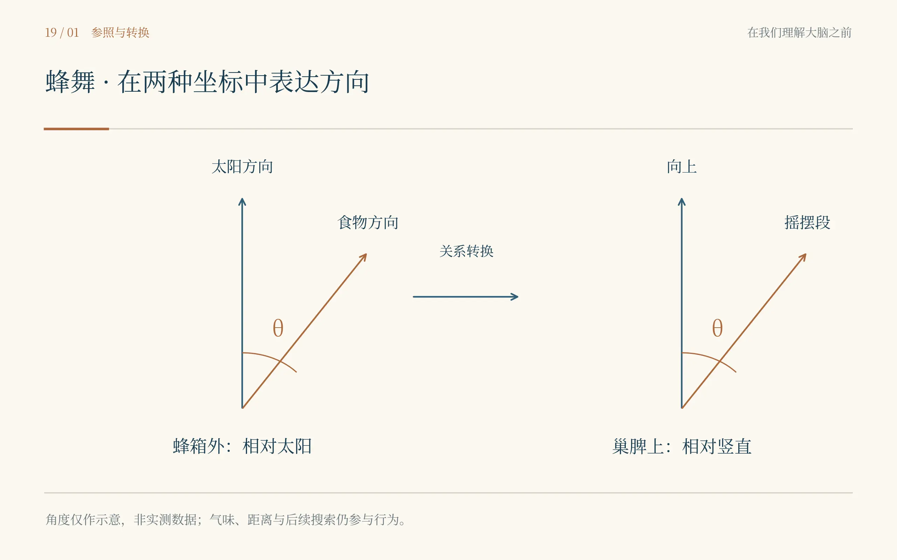
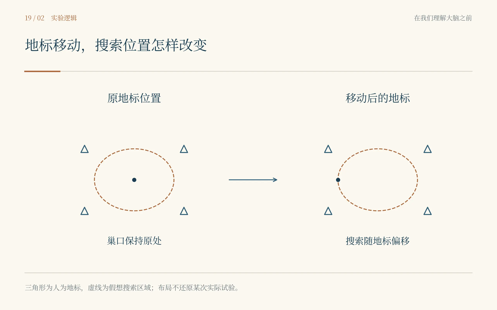
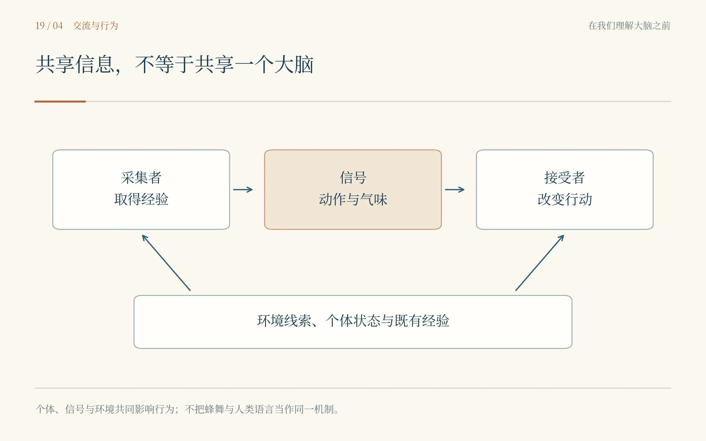

# 第十九章　蜂群没有带地图

*弗里施、洛伦茨与廷伯根：行为发生在身体与世界之间*

蜜蜂背上有一点颜色。起初我以为是花粉，老人说那是他给它做的记号。蜂箱旁的空气热烘烘的，许多蜜蜂从同一个入口钻进钻出，倘若不做记号，人比蜂更容易认错伙伴。卡尔·冯·弗里施把本子翻到新的一页，记下时间和食物的位置，再让我看那只刚回来的蜜蜂。它没有停下来休息，而是在巢脾上走起一段奇怪的路。

他让出一点地方，我低头看。蜜蜂在垂直的巢脾上走出一段摇摆的直线，转回来，再重复。旁边有别的蜜蜂靠近，触角和身体随着它移动。我很想问它在说什么，话到嘴边，又觉得自己来得太快。上一间实验室里，我们还在分清活动图与动物路线；到了这里，我不能刚看见一段动作，就替它安上一句人话。

弗里施没有急着解释。他要我先跟着同一只看。过了一会儿，我认丢了，指向另一只。他说不是。再过一会儿，我又认丢了。蜜蜂没有因为我读过生物学而变得容易区分。等我终于在一阵拥挤中认出那一点颜色时，他已经把下一条记录写完了。

桌上放着糖水，盖子要及时盖好。我帮着把一只小碟移到干净的地方，才发现“干净”也不是随便挑的位置。食物在哪里，蜜蜂从哪里来，附近留下什么气味，都可能成为实验的一部分。几乎每次穿越，我都要重新学习某一种不能随手移动的东西。

弗里施最初研究蜜蜂的感觉能力时，就得面对这种困难。蜜蜂在一块有颜色的材料上取食，并不足以证明它能分辨颜色：也可能只是材料比周围更亮或更暗。把不同明暗的灰色一起放进比较，调换位置，去掉食物后再测，才能使问题逐渐离开人的直觉。颜色在研究者眼里鲜明，并不自动等于动物正在按颜色作答。\[19.1–19.2\]

我在一张小纸上画了几个格子，把训练时的糖水位置标出来，另画一张不放糖水的测试图。弗里施看完，用指甲在格子边缘敲了两下：“这块材料用过没有？”我把图拿回来，再记上残留气味这一项。

等到中午，我已经蹲得腿麻。弗里施仍在看那些小小的身体。他并不总是显得温和，尤其当一条本来能记清的记录被说成“大概”的时候；但一只蜜蜂迟迟不来，他也没有替它着急。他会转去看另一项，把等待留在那里，仿佛等待也是仪器中不能拿掉的一部分。

我从自己的研究想到另一种情形：我们经常在一个物种身上定义出方便的测试，就拿同一套安排去问另一个物种。得不到反应时，便说它能力有限。弗里施的蜂箱让我意识到，测试也有自己的感觉世界。动物若根本没有按我们的方式看见条件，安静就不是一个足够明确的答案。

***

真正令人惊讶的并不是一只蜜蜂能找到糖水，而是其他蜜蜂也会陆续来。它们之前没有与我一起走过那段路，却似乎获得了某种消息。我跟着一名助手来到取食地点，回头已经看不见蜂箱。那些小小的身体从空中出现，落下来，像到一个并不陌生的地方。

“也许跟着气味。”我说。助手没有反驳。这个解释值得认真对待，而不是为了使舞蹈故事更好看就先扔掉。食物有气味，采集者可能带回气味，同伴到了附近也可能用气味寻找。若一种行为发生以后另一种行为跟着发生，还不能直接说前者已经传递了我想象中的全部内容。

弗里施研究的办法，是改变食物位置，再观察回来的蜜蜂怎样行动。1946年的重要报告以及后来不断扩展的实验，把摇摆舞与方向、距离之间的联系展示出来。垂直巢脾上摇摆段相对于竖直方向的角度，可以对应飞行方向相对于太阳方位的关系；舞蹈中的时间特征又与距离信息有关。这里的编码有条件、有误差，也不是每一种舞都能用同一个简单刻度概括。\[19.1,19.3\]

我把蜂箱前后的两张纸对照着看。一张在地面上，画的是太阳、蜂箱与食物；另一张立起来，画的是巢脾。最难想清的不是角度本身，而是同一个方向关系怎样从一种空间换到另一种空间。那只蜜蜂没有摊开地图给同伴看，它用身体上的动作，把一段外面的路带进黑暗的蜂群。

那天我们没有在纸上写“蜜蜂说：向左飞”。我们记动作的角度、持续时间和食物的位置，再看这些量怎样相互对应。我越来越喜欢这种朴素的写法。它没有急着减小现象，也没有急着把现象抬成人类独有的东西。一个可以检验的关系，比一句漂亮的翻译更能被后来的研究接住。

后来关于舞蹈与招募的争论，没有因为弗里施得到诺奖就全部停下。气味能解释多少，方向信息又能解释多少，仍然需要使不同解释产生不同预测。古尔德1975年的实验讨论，以及赖利等人2005年利用谐波雷达追踪被招募蜜蜂的研究，把证据进一步推向实际飞行。不能只在蜂箱门口记“它出去了”，还要尽可能知道出去以后朝哪里走。\[19.4–19.5\]

我在那些后来出现的轨迹前面，想到奥基夫实验室里单位时间的放电。只看最后到没到，可能把途中最有区分力的部分丢掉。蜜蜂可以先按收到的方向信息飞，再在附近搜索；气味仍可能帮助最后找到目标。两种机制并不一定争夺同一段路。研究把路分清，争论才有机会离开非此即彼。

这让我想起母亲在电话里说巷口修路。我先照着她给的方向走，到附近再看门牌。别人若只记录我最后敲开了门，可以说我靠记忆，也可以说我靠视觉，还可以说我听了指路；这些说法都有一点道理，却没有说清各自在什么时候发生。

林道尔来时，我正把几条轨迹排在一起。他讨论蜂群里的分工与交流，不把蜂箱想成一个小小的王国，再让一只蜂替所有同伴作决定。很多事情在个体彼此接触、交换信息和调整行为中形成。后来他的《社会性蜂类的交流》让我读得很慢，因为每一章都在提醒我，群体结果需要回到可以观察的相互作用里。\[19.11\]

傍晚收拾糖水时，我问弗里施，研究一个小脑子的动物，是否比研究人的大脑轻松。他抬头看看蜂箱，又看看已经认丢许多次蜜蜂的我。我们都没有接着说。那一刻，不需要一段哲学解释，工作已经替他回答了一半。

***

在沙地上等蜂狼回巢，比在蜂箱旁等蜜蜂又是另一种安静。尼古拉斯·廷伯根蹲得很低，注意力落在一个并不起眼的洞口附近。我站远一点，终于没有先问仪器在哪里。松果、沙地、一个被记住的位置，都可以成为实验材料，只是它们不会自动告诉人该怎样使用。

廷伯根观察到蜂狼离巢和返巢的行为，把巢口附近的视觉标志纳入实验。在1932年发表的研究中，改变巢旁标志物的位置，使动物返航后的搜索发生偏移，为视觉地标参与定位提供了证据。关键不是把整个巢搬走，而是让原来常常一起出现的巢和地标分开。\[19.6\]

我在本子上画了一个洞，又在周围画圈。他问我哪个动了。我说，圈动了，洞还在。他便让我把箭头只画在真正移动的东西旁边。那幅图很简单，可在纸上，差一点就被我画成另一个实验。我们经常把示意图当作最终说明，很少想到它也会犯一种比文字更安静的错。

动物回来时，在被移动的标志附近搜索。我没有笑它认错。它是在一个平常可靠的世界里学会寻找，现在这个世界被人拆开了一部分。错误暴露了它利用的线索，也暴露了实验者对环境拥有的权力。要让这种权力变成知识，就得把改变了什么、没改变什么和怎样判断反应交代清楚。

太阳慢慢移过去，沙地并不适合久久不动。我把外套垫在膝盖下面，廷伯根仍然盯着洞口。有人带来食物，我们轮流吃，不能所有人同时走开。科学史里一张整齐的实验图，背后也许有这样的午饭：一个人低头吃，另一个人替他看着。

后来走到海鸟的实验现场，我看到纸板与模型。它们并不都像真正的鸟，有些甚至粗糙得让我想伸手修一修。廷伯根与珀德克研究幼年银鸥的乞食反应时，改变模型的不同特征，询问究竟哪些刺激更容易引出啄击。重要的不只是一个红色标记，而是把颜色、形状、位置、动作与动物状态放进可比较的条件里。\[19.7\]

我以前读这种实验，很容易记成一句话：小鸟天生会啄红点。可一句话很快，动物的发育并不那么快。怎样孵化，此前见过什么，测试时是否饥饿，模型怎样呈现，都会影响我们有资格说多大的话。一个显著的特征可以成为入口，不能因此占满整个动物。

“它为什么这样做？”我问。廷伯根抬起头，像需要先知道我在问哪一种为什么。眼前的刺激如何引出反应，是一个问题；这只动物在成长中怎样形成这种反应，是另一个；行为在自然环境中有什么作用，它在不同物种的历史中怎样演变，又需要不同材料。1963年，他把这些问题系统写出来。它们可以相互帮助，却不能拿其中一个答案替另外几个结账。\[19.8–19.9\]

我在纸上写了四个空处，原本想填得整整齐齐，最后发现同一个词会跨过去。经验参与发育，也影响此刻；生理机制发生在现在，却有演化的历史。四个问题不是四堵墙，它们更像四种需要分别负责的问法。以前我喜欢在结果后面补一句“具有适应意义”，现在开始知道，那是另一项需要证据的工作。

那天夜里，我把自己的课题翻出来看。它在本子里只占几行，我却能想起当初写得多急：一个差异，一个脑区，一条可能的机制，再往后便接上疾病和进化。廷伯根没有让我放弃远处的问题，只让我看见中间还隔着哪些不同的证据。我把最后那根箭头擦短了一点，纸没有因此显得更空。

***

康拉德·洛伦茨出现的时候，身边先有了鸟。它们绕着人的腿移动，使人的步子也不得不改变。我早就见过那类著名照片，却从没想过一群动物会怎样占用一个家庭的门口和时间。洛伦茨说话时常转头去看它们，像有一部分谈话并没有只对着人进行。

关于鸟类社会关系与印刻的工作，使早期经验、物种特征和跟随行为之间的联系成为重要问题。1935年的研究把许多长期观察组织起来。后来的人很容易把它改写成“睁眼看见谁，就永远把谁当母亲”，但不同物种、不同条件和不同发育阶段，并不服从这句过分简便的话。\[19.10\]

我没有问他，小鸟是不是爱他。那种问法会使我忘记眼前需要测什么。我看的是它们跟随哪一个对象，怎样接近，离开后又怎样寻找。人的情感词可以使旁观者靠近动物，也可能在不知不觉中把本来需要回答的部分提前写完。

洛伦茨有时让我感到亲近，有时又使我不安。他对动物的注意很具体，谈到更大的判断时却可能走得很快。我后来读他的自传材料，看见他对自己曾受国家社会主义吸引及相关写作的交代。这不能被一群跟在身后的鸟冲淡。一个人在观察上的才华，不会使他的政治判断自动可靠，更不会替那些有害思想免去责任。\[19.14\]

我把那页材料留在书里，没有夹进最不容易看见的地方。前面我见过战争怎样把人赶出大学，见过丽塔在卧室里继续工作；到这里，不能为了使一位获奖者显得完整而删掉另一种完整。科学家不是只有领奖那一天，也不是只有最值得喜爱的那张照片。

廷伯根的战时经历与洛伦茨不同。他在自己的生平叙述中写到被德国占领者拘禁的岁月。两份材料摆在桌上，没有彼此交谈。它们不能替我安排一场和解，也不允许我因为喜欢某些实验，就把另外的事情翻过去。到了1973年，他们与弗里施在同一奖项中被表彰，也不意味着此前各自的选择与遭遇从此相抵。\[19.12,19.15\]

我开始不再喜欢“天才都有缺点”这句话。它有时只是让人更容易把具体的事放过。实验结论需要证据，历史责任也需要证据；既不因厌恶一个人就删去别人能够重复的发现，也不因佩服一个发现就替那个人的全部人生作保。

***

1973年的诺贝尔生理学或医学奖，授予弗里施、洛伦茨与廷伯根，表彰他们关于个体与社会行为的组织和诱发机制的发现。这一次，我想起的不是一个能够在脑图上圈出的单点，而是蜂箱、沙地、模型、标记过的个体与许多年观察。行为本身终于不必先被改写成某个分子，才有资格成为严肃的问题。\[19.12\]

弗里施未能亲自到场作诺贝尔演讲，诺贝尔奖档案保留了那场演讲的材料。我听到这些资料时，想到站在蜂箱旁那位要求我认清同一只蜜蜂的老人。我在会场材料旁留出一个位置，记着那个不在眼前的人。后来得到奖项，并不能使所有等待都在同一天结束。\[19.13\]

我在住处把一天的东西摊在桌上。纸上既有神经元，也有整只动物，还有动物与环境的关系。过去我总以为研究越深入，桌上的东西就会越小；现在它们有时小到一个分子，有时又必须大到一片会变化的沙地。深，并不总是向内缩。有些问题只有把周围的世界放回来，才会显出自己原来的形状。

母亲又给我讲了一遍回家的路。我说我记住了，她仍然从那个修路的巷口讲起。我听着，忽然想到蜂群里那些反复的舞。人的话当然不等同于蜂舞，可一种经验能够改变另一个身体的行动，这件事在此刻使我感到真实。我没有打断她，也没有把这种联系告诉她。

说完方向，她问我有没有带厚一点的衣服。我低头看见外套的袖口沾着沙，口袋里还有一张画着巢口的小纸。这些日子里，我一直想知道脑怎样保存世界；如今，别人还会把我没见过的变化送进来。我的世界从来不只由我独自取得。

挂断电话后，我把手机放在左手，又用右手拿笔。两只手各做各的事，我没有觉得自己被分成两个人。这个平常的协调，却在我合上本子时变得陌生：这么多不同来源的消息，怎样最后都变成“我知道”？如果有一部分消息不能传到说话的地方，没说出来的那一部分又属于谁？

房间里的光暗了一下，再亮起来时，桌上多了一块挡板。有人让我坐到旁边，不要抢着提示。挡板后面是一双手，一双属于完整生活中的人的手。那个人向我问好。我也向他问好，然后把关于蜂群的那张纸收了起来。

---

## 史实与创作说明

史实与虚构。蜂舞、蜂狼定位、银鸥乞食与鸟类印刻依据原始工作及研究者档案展开。主角认错蜜蜂、移动食物、垫外套、电话与现场对白为文学情节。对洛伦茨的历史责任依据其自述材料交代，不为人物编造未记录的忏悔或对质。

解释边界。蜂舞编码与气味、搜索、环境线索可以共同参与招募。动物的学习与感知条件应按物种、发育阶段和任务区分；印刻不等于一切物种“睁眼看见谁就永远认谁”。观察到反应模式也不能直接赋予人类式主观情感。\[19.1–19.11\]

学习线索。让竞争解释给出不同预测；改变地标而保留巢位；分别回答即时机制、个体发育、适应功能与演化历史。廷伯根的四问是互相补充的研究视角，不是彼此封闭的四种现象。\[19.6–19.9\]

文献与图像说明。参考文献\[19.7\]常以1950年引用，部分数据库或出版平台记为1951年；卷页与DOI指向同一篇文章。四幅图为概念重绘，未复用历史照片；蜂舞角度、地标位置与流程均为说明逻辑而设，不是真实追踪轨迹。\[19.7,19.12–19.15\]

## 本章插图

{fig-align="center" width="90%"}

{fig-align="center" width="90%"}

{fig-align="center" width="90%"}

{fig-align="center" width="90%"}

## 本章参考文献

- [19.1] von Frisch K. The Dance Language and Orientation of Bees. Cambridge, MA: Harvard University Press; 1967.
- [19.2] von Frisch K. Der Farbensinn und Formensinn der Biene. Jena: Fischer; 1914. 原著数字化版本。 在线档案
- [19.3] von Frisch K. Die Tänze der Bienen. Österreichische Zoologische Zeitschrift. 1946;1:1–48.
- [19.4] Riley JR, Greggers U, Smith AD, Reynolds DR, Menzel R. The flight paths of honeybees recruited by the waggle dance. Nature. 2005;435:205–207. DOI: 10.1038/nature03526
- [19.5] Gould JL. Honey bee recruitment: the dance-language controversy. Science. 1975;189:685–693. DOI: 10.1126/science.1154023
- [19.6] Tinbergen N. Über die Orientierung des Bienenwolfes (Philanthus triangulum Fabr.). Zeitschrift für vergleichende Physiologie. 1932;16:305–334. DOI: 10.1007/BF00338750
- [19.7] Tinbergen N, Perdeck AC. On the stimulus situation releasing the begging response in the newly hatched herring gull chick (Larus argentatus argentatus Pont.). Behaviour. 1950;3:1–39. DOI: 10.1163/156853951X00197
- [19.8] Tinbergen N. The Study of Instinct. Oxford: Clarendon Press; 1951.
- [19.9] Tinbergen N. On aims and methods of Ethology. Zeitschrift für Tierpsychologie. 1963;20:410–433. DOI: 10.1111/j.1439-0310.1963.tb01161.x
- [19.10] Lorenz K. Der Kumpan in der Umwelt des Vogels. Journal für Ornithologie. 1935;83:137–213. 第一部分。 DOI: 10.1007/BF01905355
- [19.11] Lindauer M. Communication among Social Bees. Cambridge, MA: Harvard University Press; 1961.
- [19.12] Nobel Prize. The Nobel Prize in Physiology or Medicine 1973: Summary. 1973. 在线档案
- [19.13] von Frisch K. Decoding the Language of the Bee. Nobel Lecture, 12 December 1973. 演讲材料与现场记录。 在线档案
- [19.14] Lorenz K. Konrad Lorenz: Biographical. Nobel Prize archive. 研究者自述与历史责任相关材料。 在线档案
- [19.15] Tinbergen N. Nikolaas Tinbergen: Biographical. Nobel Prize archive. 研究者自述。 在线档案
