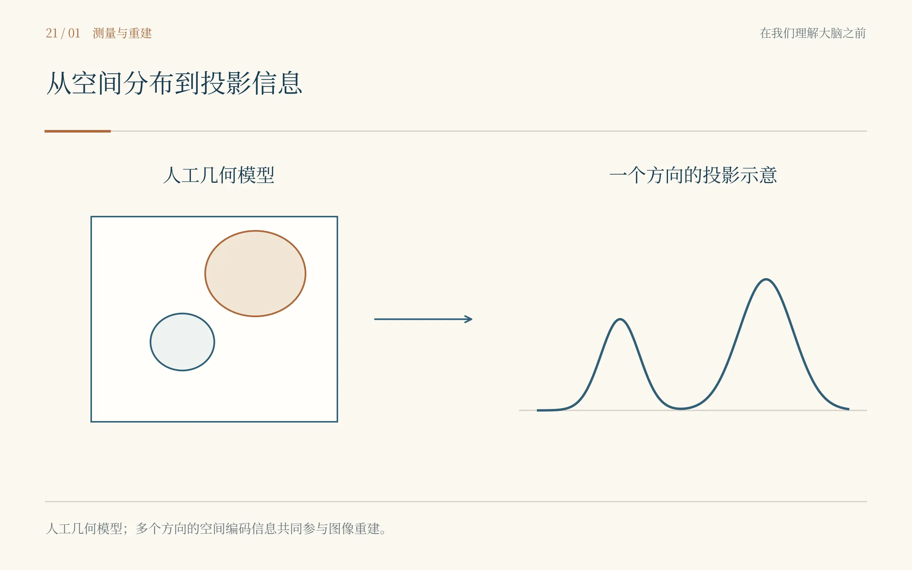
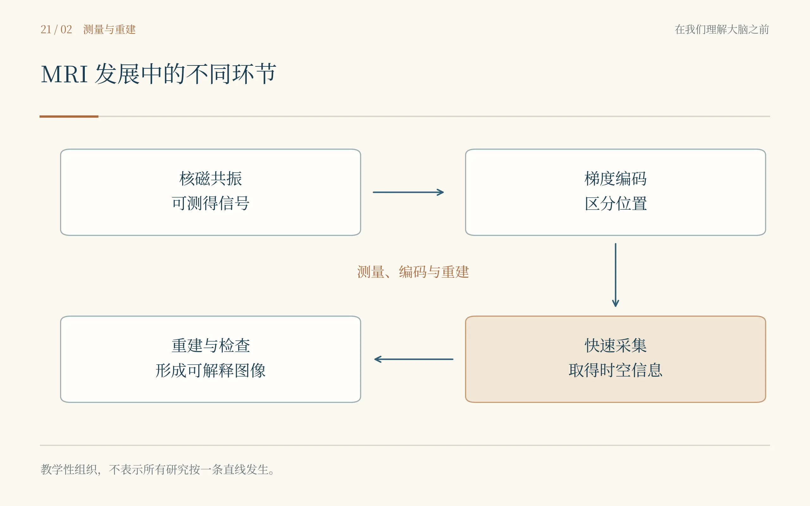
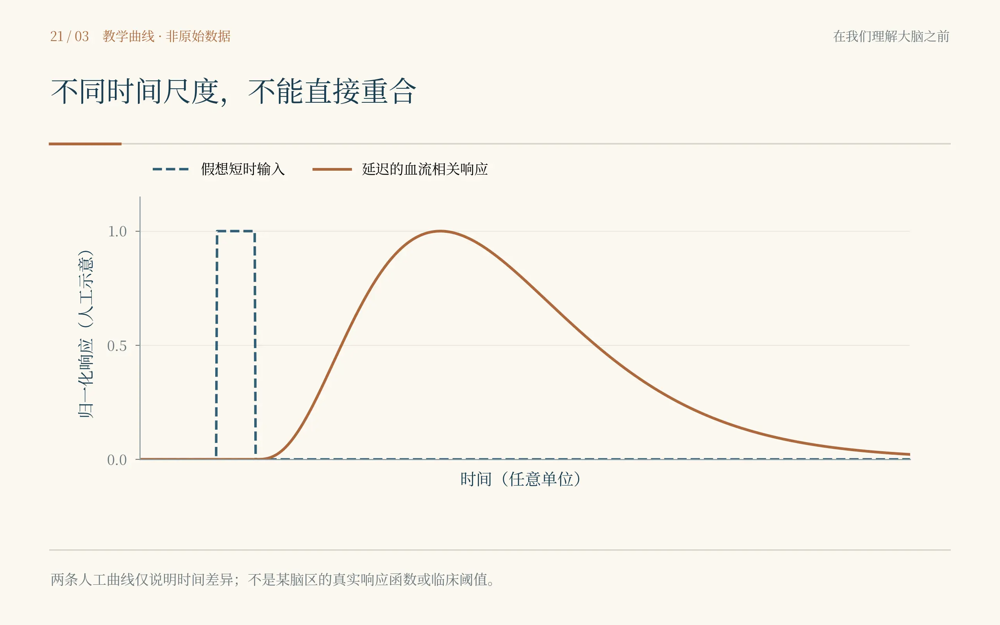
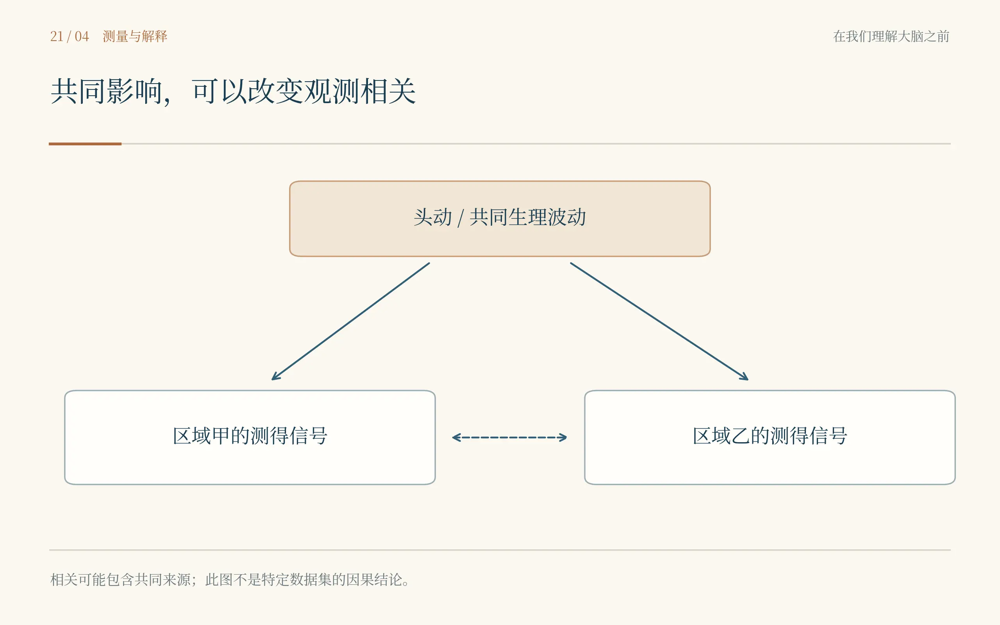

# 第二十一章　图像亮起来以前

*劳特伯与曼斯菲尔德：从核磁共振到活人的脑图*

桌上并排放着两小管水。劳特伯把纸翻过来，在背面画下两个位置，问我怎样才能分清它们。我说给它们贴标签。他笑了，把两管水挪到看不见标签的地方。几秒后，我就明白自己答错了。磁共振装置只肯交出一堆信号，不会替我们记住每一滴水原来坐在哪里。

我站在纽约州立大学石溪分校的实验室里，面前没有可以让患者躺下的长床，也没有门上那种熟悉的安全警示。七十年代初，磁共振成像还没有成为我每天使用的图像文件。它首先是一个需要解决的分离问题：怎样使不同位置的信号带上可以辨认的差别。

劳特伯不像急着给学生看成品的人。他讲到某个地方，会忽然回头改图，仿佛纸上的线也有责任跟上他的想法。我把本子摊开，习惯性想记一个标准流程，写了几行才发现，他正在做的并没有被整理成流程。今天觉得理所当然的编码，在这里仍需要问，究竟能不能用。

核磁共振并不是从这两管水开始的。1946年，布洛赫等人与珀塞尔、托里、庞德等人的研究分别使凝聚物质中的核磁共振测量取得突破。某些原子核在外加磁场与适当射频条件下表现出的响应，后来为测量物质、研究分子以及成像提供了基础。若跳过这一层，劳特伯的纸上就好像凭空出现了一种会发出消息的水。\[21.1,21.2\]

我小时候见过收音机转动旋钮。这个记忆帮我理解不同条件对应不同频率，却也很容易使我误以为每个位置天生都有一个频道。劳特伯真正利用的是有意安排的磁场梯度：让磁场随位置改变，从而使共振条件携带空间信息。位置不是自己报上来的，是实验者为它建立了可以区分的编码关系。\[21.3\]

我说这是不是故意把磁场弄得不均匀。他点头。我曾经在仪器故障说明里反复见到“不均匀”三个字，总觉得它只是一种需要消除的东西。现在，同一种物理差异在被控制、被定量之后，竟成为新的测量办法。我把“误差”两个字划去，旁边写上“已知的变化”。

一组投影仍不足以还原任意的空间分布。改变梯度方向，取得不同方向的信息，再通过重建把它们联系起来，才可能让物体的位置逐渐显现。1973年的那篇短文给出了这样的成像实例。今天看来很简陋的图，在当时跨过的是从一份综合信号到空间分布的一道门。\[21.3\]

我盯着结果，忍不住想把边缘描得圆一些。劳特伯问原始信号是否允许那样做。我说只是为了看起来更像两管水，他把纸拉近，重新对照记录。我第一次觉得，一个人知道物体是什么，反而会使他更容易把自己的知识画进图像。图该与物体接近，但不能靠研究者替缺少的证据补齐。

这使我想起卡哈尔的画。那时候我担心手绘不够客观，以为机器会使这个问题消失。来到这里才知道，机器取得的信号也要经过编码、重建和显示。问题不是有手就主观、没有手就客观，而是每一步改变都应该知道根据什么，并使别人有机会检查。

***

到了诺丁汉，彼得·曼斯菲尔德把我注意的事情又推向另一边。他和格兰内尔从磁场梯度下的信号关系出发，研究空间信息怎样被提取。1973年关于核磁“衍射”的论文，后来与成像发展发生了重要联系。它并不是劳特伯房间里同一张图的另一份署名，而是一条具有自己物理出发点的研究道路。\[21.4\]

曼斯菲尔德看装置时很专注。我问以后是不是能看见完整的大脑，他没有立即谈人体，只问取得这些信息要多久。我的第一个念头是，慢一点也没关系，总能等。话说出口以后，我想到参与者在扫描里的一次吞咽、一点转头，还有无法永远屏住的呼吸。活着的身体不会为了等一幅图而彻底静止。

速度不是写在机器宣传页上的另一项指标。若采集期间物体改变，信息就不再像我们假定的那样来自一个稳定对象。若要追踪活动，太慢又会使变化混在一起。曼斯菲尔德后来提出的回波平面成像思路，推动了快速取得图像的可能性。1977年的工作是这条路上的关键节点之一，但从想法到可靠使用，还需要许多人的技术改进。\[21.5\]

有一天，我等一组结果，越等越困。旁边的研究者去检查装置，我守着纸，心里只想赶快结束。等他回来，先问刚才有没有出现不寻常的声音。我说好像没有，随即又不确定。疲倦使我的“没有”听起来比观察实际支持的更肯定。我把那一段标注出来，第一次不再把等待仪器的时间全当成空白。

图像与医学的联系，还经过其他人的研究。达马迪安1971年的论文比较组织的核磁共振弛豫特性，并提出肿瘤检测方面的可能。这与利用空间编码形成图像不是同一个命题。评价不同贡献时，既不能把组织差异直接写成已经完成全身成像，也不能因后来的奖项只列出部分名字，就假装其他问题从未被提出。\[21.6\]

我以前很喜欢问谁是某项技术的发明者，仿佛找到一个名字就能给整段历史关门。可是眼前既有基础物理，有材料测量，有空间编码，又有快速采集、重建、线圈与系统工程。最后形成一种日常技术，并不意味着此前所有道路从一开始都通向同一扇门。

2003年，劳特伯与曼斯菲尔德因磁共振成像方面的发现共同获得诺贝尔生理学或医学奖，各占一半。奖项所说的是成像的发展，并没有把后来我常用的功能磁共振分析全部算作两个人在七十年代已经完成的工作。看到那个获奖理由时，我特意没有在旁边补上“读懂思想”四个字。\[21.7\]

在那一年的资料里，我再次看见两人的名字，想到的却是等待中的装置和两小管水。它们还没有脸，没有疾病名称，也没有一个病人躺在里面。但使位置能够被看见，已经改变了后来无数人提出问题的方式。基础研究有时并不在开始的那一页就说出自己最终会帮助谁。

***

我以为看见活着的大脑以后，最初那张功能连接图终于快有答案了。可结构图像只是第一层。脑区在什么地方、组织看起来怎样，与某一时刻神经系统正在怎样活动，并不是同一种问题。若要跨过去，需要一个会随着生理过程改变、又能够被测量的信号。

这条路上出现了一个我早已见过的名字。1890年，罗伊与谢灵顿发表关于脑血液供应调节的研究。谢灵顿没有在那时发明功能磁共振，但他所参与的问题，使神经活动与局部循环之间的联系早早进入研究。后来出现在电脑屏幕上的亮点，仍然带着这一层生理关系。\[21.8\]

我在纸上写“神经元放电”，又写“血流”。两者之间留了一段距离。过去我常把它们用一个箭头连上，写完就往下走；现在那个空白里多出了供氧、耗氧、血容量、血管反应和时间。它们并不互相无关，却也不是同一个东西换了一个名字。

到小川诚二与同事的工作中，这段联系获得了可以用于成像的重要入口。1990年的研究表明，血液氧合状态能够影响磁共振图像对比；脱氧血红蛋白的磁性质在其中发挥关键作用。后来被称为血氧水平依赖的信号，便来自这类生理与物理过程的交会，而不是神经元自己在图上发出彩色的光。\[21.9\]

我坐在旁边，先看见的是血管附近的对比，不是一块已经命名的认知功能区。小川把不同条件放在一起，像是在听一个微小却重复出现的差别。我问这样是不是能看见思考。他没有先回答那个大词，只让我们看看哪些条件改变时，对比也会随之改变。

如果一个信号会受氧合影响，那么血管和生理状态便不能永远作为无关背景被清除。它们既使测量成为可能，也可能影响解释。能够间接反映一个过程，不表示它只是那个过程的透明副本。我想起贝凯西的标本，想起离子通道旁的电极，原来每一种看见都要经过自己的媒介。

1992年，匡、班德蒂尼、小川及各自合作者的研究，从不同实验安排推动了人脑功能磁共振的发展。视觉刺激、运动任务与快速成像，使神经活动相关的动态信号能够在活体中被研究。这里有多个团队，不是一位科学家看见一张图以后，整个领域就同时完成了。\[21.10–21.12\]

我跟着一位参与者进入检查前的房间。她先问要躺多久，又问声音大不大。研究者检查相关安全事项，解释任务和中止方式。我站在旁边，忽然想起自己写方法学时那句“所有受试者均完成扫描”。一句话里，耳塞、等待、紧张、保持不动与被认真告知的过程，全都看不见了。

扫描开始以后，机器的声响使我难以继续想那些抽象问题。我看着任务时间表，第一次清楚地感觉到，某一幅后来被我平均进组图的图像，曾经对应一个人正在努力配合的几分钟。若没有人听清指令，或中途出现了困难，一张看起来完整的文件并不能独自证明实验完整。

***

2001年，洛戈塞蒂斯与同事把电生理和功能磁共振联系起来，在特定实验条件下比较局部神经信号与血氧水平依赖响应。研究发现，局部场电位与所测血氧信号的关系，比简单把它看成单个神经元放电计数更值得重视。这个结果使解释更具体，却不应被推广为所有脑区、任务和状态都只有同一种对应。\[21.13\]

我把原来写的“这里放电更强”改成“这里的血氧相关响应不同”。改完以后，句子显得不那么有气势。我盯着它，忽然想笑。穿越这么多次，似乎总有人在帮我把最响亮的词拿走。但留下的并不是软弱，而是一种更能承受追问的描述。

接着出现了我最熟悉的研究背景：安静躺着，没有明确外加任务，信号仍在变化。比斯瓦尔与同事1995年的工作，在静息状态的运动相关区域观察到时间波动的相关性，为后来功能连接研究提供了重要起点。休息并不是大脑关机，相关波动也不自动等于两区之间有一根被直接测到的纤维。\[21.14\]

我看着那几条曲线，几乎觉得自己已经回到2026年。相关系数、时间序列、区域，我可以立刻接下去说许多话。可经历过前面那些房间以后，熟悉不再使我放心。我开始问，两条线为什么一起变，可能共同受到什么影响，测量与预处理又改变了什么。

鲍尔与同事2012年的研究明确显示，头动能够在功能连接结果中引入系统性影响。这并不是说所有连接都是头动，也不是只要在模型里放进一个运动参数就保证问题消失。它说明一些看似有空间结构的差异，可能部分来自参与者怎样移动以及数据怎样被处理。\[21.15\]

我又想起离开实验室前的那张脑图。那时候我检查头动，是为了确定结果还能显著；现在我更想知道，结果在什么合理的处理下保持什么部分，在哪些条件下变得不稳。一个不方便的敏感性结果，不该被当成妨碍故事的纸张。它可能在告诉我，故事究竟站在哪里。

我没有因此讨厌脑图。恰恰相反，知道它经过多少层测量以后，我更珍惜它能够提供的东西。非侵入地观察活人的脑结构与活动相关变化，使许多此前难以安排的问题能够被研究。限制不是使一种技术失去价值，而是使研究者知道怎样把价值用在能够支持的地方。

那天最后一位参与者离开时，研究者把灯调亮，整理下一次要用的材料。我看见椅子上留了一根头发，便用纸巾收起来。图像已经进了文件夹，人却回到自己的生活。我忽然想起裂脑房间里的那位参与者：他们不是为了让我们拥有更好的图，才拥有自己的身体。

我在本子上画了一座桥。一端是氢核和梯度，一端是人在机器里完成一次任务，中间写上血管、重建、统计和许多需要核对的条件。桥很长，但不是虚假的。只是走到了桥的另一端，还不能直接跳进一个人的全部思想。

门外有人拿着检查单等候。他问医生，看见问题以后能不能治。医生把纸接过去，没有立刻说可以。我站在那里，发现这比我以前对脑科学的想象更直接。人们并不只想知道哪一块组织不同；他们还想知道，能不能少受一点苦，能不能恢复自己想过的生活。

从看见到解释，还有一段路。从解释到改变一个人，路更长。我把桥的另一端留空，没有先画上一把手术刀。可走廊的光已经变了，另一份纸在我面前展开，上面写着一个我在1949年的奖项里见过的名字。

莫尼兹。

---

## 史实与创作说明

史实与虚构。核磁共振的基础发现、空间编码、快速成像、BOLD及静息态研究按不同年代与团队交代。两管水旁的对话、主角描边、临床参与者与工作现场为文学重构，不能当作获奖者的现场记录。

关键区分。MRI成像不是直接拍摄神经元，BOLD也不是神经放电的等量读数。神经—血流关系随组织、状态和实验条件而变化；相关信号的联系不能直接等同于解剖纤维、信息因果传递或被试的全部心理内容。\[21.8–21.15\]

学习线索。追问信号怎样产生、怎样取得空间信息、怎样被重建和统计。了解头动、共同生理波动与分析选择可能带来的影响，同时保留非侵入成像在对应问题上的实际价值；限制不是否定技术的理由。

奖项与图像。2003年劳特伯与曼斯菲尔德各获一半，奖项理由为MRI相关发现，并未将其等同于后来所有fMRI工作。四幅图含人工几何模型、概念时间曲线和因果结构，不是历史仪器照片、真实影像或患者结果。\[21.1–21.15\]

## 本章插图

{fig-align="center" width="90%"}

{fig-align="center" width="90%"}

{fig-align="center" width="90%"}

{fig-align="center" width="90%"}

## 本章参考文献

- [21.1] Bloch F, Hansen WW, Packard M. Nuclear induction. Physical Review. 1946;69:127. DOI: 10.1103/PhysRev.69.127
- [21.2] Purcell EM, Torrey HC, Pound RV. Resonance absorption by nuclear magnetic moments in a solid. Physical Review. 1946;69:37–38. DOI: 10.1103/PhysRev.69.37
- [21.3] Lauterbur PC. Image formation by induced local interactions: examples employing nuclear magnetic resonance. Nature. 1973;242:190–191. DOI: 10.1038/242190a0
- [21.4] Mansfield P, Grannell PK. NMR “diffraction” in solids? Journal of Physics C: Solid State Physics. 1973;6:L422–L426. DOI: 10.1088/0022-3719/6/22/007
- [21.5] Mansfield P. Multiplanar image formation using NMR spin echoes. Journal of Physics C: Solid State Physics. 1977;10:L55–L58. DOI: 10.1088/0022-3719/10/3/004
- [21.6] Damadian R. Tumor detection by nuclear magnetic resonance. Science. 1971;171:1151–1153. DOI: 10.1126/science.171.3976.1151
- [21.7] Nobel Assembly. The Nobel Prize in Physiology or Medicine 2003: Press release. 2003. 在线档案
- [21.8] Roy CS, Sherrington CS. On the regulation of the blood-supply of the brain. Journal of Physiology. 1890;11:85–158. DOI: 10.1113/jphysiol.1890.sp000321
- [21.9] Ogawa S, Lee TM, Kay AR, Tank DW. Brain magnetic resonance imaging with contrast dependent on blood oxygenation. Proceedings of the National Academy of Sciences USA. 1990;87:9868–9872. DOI: 10.1073/pnas.87.24.9868
- [21.10] Kwong KK, et al. Dynamic magnetic resonance imaging of human brain activity during primary sensory stimulation. Proceedings of the National Academy of Sciences USA. 1992;89:5675–5679. DOI: 10.1073/pnas.89.12.5675
- [21.11] Bandettini PA, Wong EC, Hinks RS, Tikofsky RS, Hyde JS. Time course EPI of human brain function during task activation. Magnetic Resonance in Medicine. 1992;25:390–397. DOI: 10.1002/mrm.1910250220
- [21.12] Ogawa S, et al. Intrinsic signal changes accompanying sensory stimulation: functional brain mapping with magnetic resonance imaging. Proceedings of the National Academy of Sciences USA. 1992;89:5951–5955. DOI: 10.1073/pnas.89.13.5951
- [21.13] Logothetis NK, Pauls J, Augath M, Trinath T, Oeltermann A. Neurophysiological investigation of the basis of the fMRI signal. Nature. 2001;412:150–157. DOI: 10.1038/35084005
- [21.14] Biswal B, Yetkin FZ, Haughton VM, Hyde JS. Functional connectivity in the motor cortex of resting human brain using echo-planar MRI. Magnetic Resonance in Medicine. 1995;34:537–541. DOI: 10.1002/mrm.1910340409
- [21.15] Power JD, Barnes KA, Snyder AZ, Schlaggar BL, Petersen SE. Spurious but systematic correlations in functional connectivity MRI networks arise from subject motion. NeuroImage. 2012;59:2142–2154. DOI: 10.1016/j.neuroimage.2011.10.018
