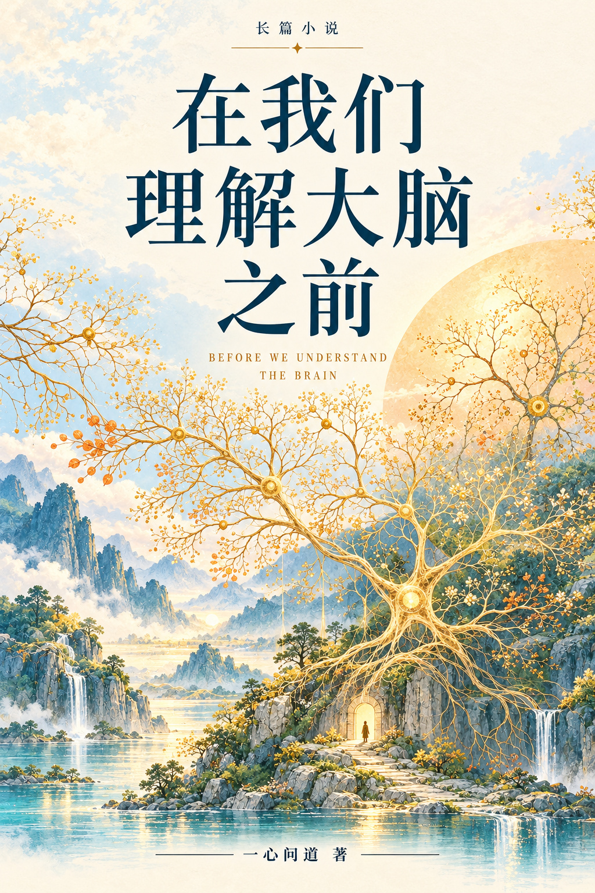

# 在我们理解大脑之前

{fig-align="center" width="40%"}

::: {.cover}
::: {.cover-small}
生命科学 × 科学史 × 穿越小说
:::
::: {.cover-title}
在我们理解大脑之前
:::
::: {.cover-sub}
一个博士生穿越百年神经科学
:::
::: {.cover-bottom}
全书24章 · 免费在线阅读（图文版）
:::
:::

凌晨，电脑上的脑图还亮着。导师只问：“图很好看。然后呢？”一个答不上来的博士生，就这样走进了卡哈尔的显微镜、凌晨三点的两颗蛙心，还有一间放着鸡蛋的卧室。起初，他急着寻找答案。后来，他开始记住实验台旁的人，也开始听清母亲在电话里的停顿。

## 在线阅读目录

### 第一部　大脑是什么

- [第一章　黑色的森林](ch01.qmd)
- [第二章　神经系统不是电线](ch02.qmd)
- [第三章　凌晨三点的两颗心](ch03.qmd)
- [第四章　一根比铅笔芯还粗的神经](ch04.qmd)
- [第五章　卧室里的实验室](ch05.qmd)

### 第二部　大脑开始组织世界

- [第六章　倒过来的世界](ch06.qmd)
- [第七章　一个叫Tan的人](ch07.qmd)
- [第八章　一条斜线](ch08.qmd)

### 第三部　世界怎样抵达我

- [第九章　电话那头的人](ch09.qmd)
- [第十章　没有名字的气味](ch10.qmd)
- [第十一章　身体先知道](ch11.qmd)

### 第四部　身体开始行动

- [第十二章　那杯水为什么要喝](ch12.qmd)
- [第十三章　重新迈出的那一步](ch13.qmd)
- [第十四章　关了灯，天还会亮](ch14.qmd)

### 第五部　过去如何留在身体里

- [第十五章　脚步声先到了](ch15.qmd)
- [第十六章　他又向我问好](ch16.qmd)
- [第十七章　海水留下的东西](ch17.qmd)
- [第十八章　地图上还没有家](ch18.qmd)

### 第六部　我们怎样成为自己

- [第十九章　蜂群没有带地图](ch19.qmd)
- [第二十章　说不出来的那一半](ch20.qmd)
- [第二十一章　图像亮起来以前](ch21.qmd)
- [第二十二章　安静不等于康复](ch22.qmd)
- [第二十三章　没有说出的回答](ch23.qmd)
- [第二十四章　回到那张脑图](ch24.qmd)

## 阅读说明

全书二十四章及插图均已公开，读者可自由逐章阅读，也可下载完整 PDF 电子书。小说以神经科学史为背景，历史人物及重大实验有资料可查；文学化的对话与情节为作者创作。史实和参考文献持续校订。

全书81幅插图已统一美化。在线阅读时，点击插图可查看高清大图，下方可展开完整图注。完整 PDF 共317页，约11 MB，保留可点击目录、章节书签及参考文献。

作者：一心问道。

[下载完整图文电子书](https://zbyloveyj.github.io/brain-novel/downloads/brain-novel-complete.pdf?v=20261013bright)

## 作者介绍 {#author}

一心问道，华南理工大学生物医学工程博士在读，热爱脑科学、神经科学与计算生物学，关注生命现象背后的规律，也好奇那些尚未得到回答的问题。

创办微信公众号“生信与人工智能”，分享生物信息学、人工智能与交叉研究的知识、方法和思考，累计阅读量超过55万。希望把自己读过、学过、反复思考过的东西讲清楚，让更多人能够走近这些领域。

最近开始迷上写小说和制作 AI 视频，尝试用文字与影像讲述科学，也讲述科学背后的人。《在我们理解大脑之前》便是在这样的兴趣中写成的：沿着神经科学发展的足迹，走进那些发现尚未发生的时刻，看看实验台旁的人怎样工作、等待，又怎样面对自己的生活。

科研之外，愿意继续做一个好奇的人，多读一点，多看一点，也把值得记下的故事慢慢写下来。

